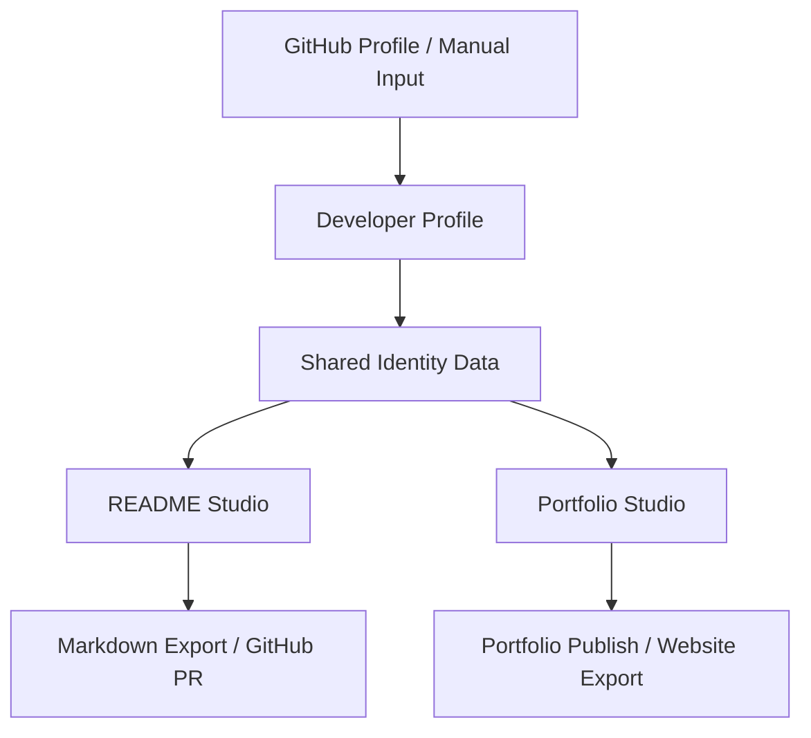

 

# GitFront

### Your code tells a story. Make your developer identity tell it better.

**A unified workspace for crafting exceptional GitHub READMEs and professional developer portfolios.**

 

*One developer profile. Two powerful ways to present it.*

 

[Explore the Repository](https://github.com/Garvittt-API/GitFront) · [Report an Issue](https://github.com/Garvittt-API/GitFront/issues)

---

## ✦ The Vision

Your GitHub profile is often the first impression you make as a developer. But creating a compelling README and maintaining a polished portfolio shouldn't mean juggling multiple tools, manually copying project details, or fighting with Markdown and frontend code.

**GitFront is being built to bring your developer identity into one workspace.**

Create your developer profile once, shape it into a beautiful GitHub README, and transform the same foundation into a professional portfolio.

No disconnected profiles. No repetitive updates. Just one identity, presented your way.

---

## ◈ Two Studios. One Identity.

<table>
<tr>
<td width="50%" valign="top">

### 01 — README Studio

**Turn your GitHub profile into a statement.**

Create expressive, structured and visually polished GitHub profile READMEs without having to write every line of Markdown yourself.

- Import public GitHub profile data
- Curate your developer information
- Showcase selected repositories
- Explore original README templates
- Edit with a live preview
- Export clean Markdown
- Prepare changes for GitHub publishing

</td>
<td width="50%" valign="top">

### 02 — Portfolio Studio

**Turn your work into an experience.**

Build a professional developer portfolio from the same profile that powers your README.

- Create a personalized portfolio
- Choose and customize templates
- Organize projects and skills
- Control section visibility and order
- Preview responsive layouts
- Publish a public portfolio
- Export your website

</td>
</tr>
</table>

---

## ⚡ What Makes It Different?

| Principle | What it means |
|---|---|
| **One identity** | Maintain a single structured developer profile. |
| **Two experiences** | Generate both README and portfolio presentations. |
| **GitHub-aware** | Use imported repository information as a starting point. |
| **Human-controlled** | Review and curate content before publishing. |
| **Design-first** | Prioritize presentation, readability and customization. |
| **Built to evolve** | Keep room for future integrations and capabilities. |

---

## ⌘ How It Works

The core idea is simple:

**Create once → Customize independently → Publish confidently.**

Your profile remains the shared foundation, while each studio controls how that information is presented.

---

## 🧩 Product Roadmap

GitFront is being developed in deliberate stages.

- [x] Repository initialized
- [x] Initial documentation workspace created
- [ ] Product requirements and scope finalized
- [ ] Complete system architecture
- [ ] Core developer profile engine
- [ ] GitHub profile import
- [ ] README Studio
- [ ] Portfolio Studio
- [ ] Authentication and profile persistence
- [ ] Version history and publishing workflows
- [ ] Security, quality and performance verification
- [ ] Public release

Roadmap items represent development goals, not claims of completed functionality.

---

## 🏗️ Engineering Philosophy

GitFront is being designed around a few foundational decisions:

- **Modular architecture:** Keep product capabilities organized without unnecessary infrastructure complexity.
- **Data integrity:** Separate imported GitHub information from user-curated content.
- **Versioned content:** Preserve revisions so changes can be reviewed and recovered.
- **Security by design:** Keep authorization, ownership and publishing permissions explicit.
- **Progressive development:** Validate each milestone before moving to the next.
- **AI with human oversight:** Make AI assistance useful without allowing it to invent achievements or publish unreviewed content.

---

## 🛠️ Technology

The final technology stack and architecture are being evaluated and documented.

Rather than listing unverified technologies, this section will be updated once the architecture is approved and implementation is established.

---

## 🗺️ Development Status

Currently in the product definition and architecture phase.

GitFront is an active project under development. The immediate focus is to establish a reliable documentation foundation, finalize the architecture, and then build and verify both studios.

Features, integrations and release dates will be documented as they become real.

---

## 🤝 Contributing

GitFront is currently in its early development stage.

If you have ideas, feedback or suggestions, feel free to open an issue in the repository.

- [Open an Issue](https://github.com/Garvittt-API/GitFront/issues)
- [Explore the Source](https://github.com/Garvittt-API/GitFront)

Contribution guidelines will be added as the project matures.

---

## 📜 License

The project's license has not yet been finalized. Until a license is added, all rights remain with the copyright holder.

---

### Built for developers who care about how their work is presented.

**GitFront** · Create your identity. Shape your story.

Made with intention. Built one milestone at a time.

