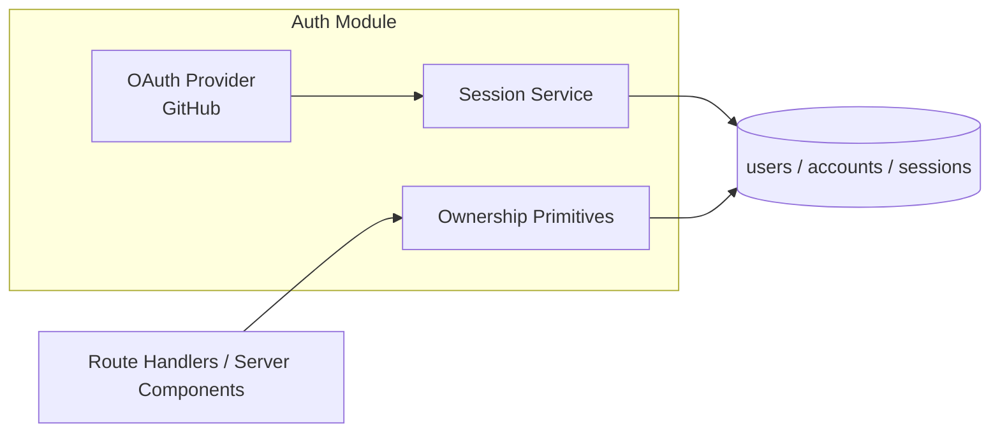
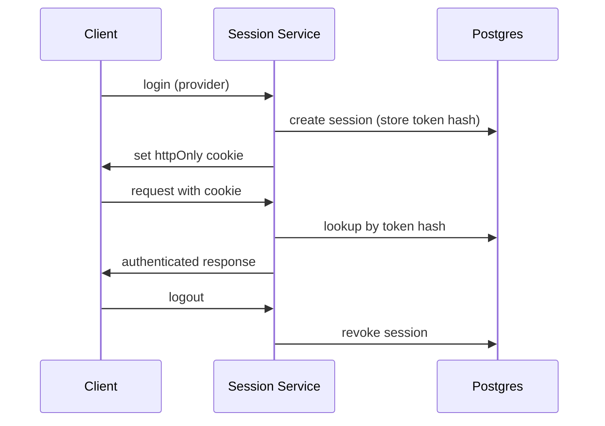

# Authentication Architecture

**Status:** Architecture design (Phase 2)
**Last updated:** 2026-11-26

---

## 1. Overview

Authentication identifies a user and establishes a revocable session. Authorization determines what that user may access (always scoped to their own data). GitHub **sign-in** is identity only — it grants **no** repository modification permission.

## 2. Identity model

- **users**: internal identity (email, display name).
- **accounts**: one or more linked providers per user (GitHub primary; email/magic-link and Google as future).
- **sessions**: opaque, server-side, revocable sessions.

A user is identified by their `users.id`. Provider identity is resolved through `accounts`.

## 3. Providers

| Provider | Status | Notes |
|---|---|---|
| GitHub OAuth | Primary (MVP) | `read:user`, `user:email` scopes |
| Email / magic link | Future | Add as an `accounts` row type |
| Google | Future | Add as an `accounts` row type |

**NEEDS VERIFICATION:** GitHub OAuth app creation, callback URL, and any rate/limit specifics. Email provider selection/limits (see ADR-021).

## 4. Session management

- **Opaque tokens:** high-entropy random tokens; only the **hash** is stored in `sessions`.
- **Cookie:** `httpOnly`, `Secure`, `SameSite=Lax`, scoped path, configurable lifetime.
- **Revocation:** logout, password/credential change, and account-takeover response revoke sessions.
- **Rotation:** refresh with rotation to limit token lifetime.
- **Metadata:** `user_agent`, `ip`, `last_used_at` for anomaly detection.

## 5. Authorization model

- **Object-level authorization:** every resource access is scoped by `user_id`. A user can only read/edit their own profile, revisions, versions, publications, and jobs.
- **Ownership primitives:** `requireUser(req)` (authenticated) and `requireOwnership(req, resource, userId)` (owns resource). All Route Handlers use these.
- **No cross-account access:** queries always filter by `user_id`; there is no path to another user's data.

## 6. GitHub sign-in ≠ repo permission

- Sign-in OAuth grants identity only.
- Repository write access is a **separate, explicit** GitHub App installation grant.
- The auth module never handles repo permissions; the GitHub integration module owns installation/publishing authorization.

## 7. Account linking

- GitHub sign-in creates/links an `accounts` row (`provider='github'`).
- Future email sign-in links as a second `accounts` row to the same `users.id`.
- If a GitHub account maps to an existing email user, link by verified email; otherwise create a new user.
- Prevent account takeover via email verification for email-based flows.

## 8. Security controls

| Threat | Control |
|---|---|
| Session theft | httpOnly cookies, short lifetime, rotation, revocation |
| CSRF | `SameSite=Lax`, origin checks on state-changing routes |
| Token theft | opaque server-side tokens; never in client storage |
| Account takeover | revocation on credential change; anomaly signals (ip/ua) |
| Enumeration | UUIDs, generic error messages |
| Auth bypass | server-side session validation on every protected route |

See `SECURITY_ARCHITECTURE.md` for the full threat model.

## 9. Configuration

- Server-side env only: OAuth client id/secret, App id/secret, session secret, cookie settings.
- Validate required config at startup; fail fast if missing.

## 10. Boundaries

- The auth module exposes `getUser`, `requireUser`, `requireOwnership`, `createSession`, `revokeSession`.
- No client component reads session internals or tokens.
- No other module implements its own auth checks; it consumes the auth module's primitives.
