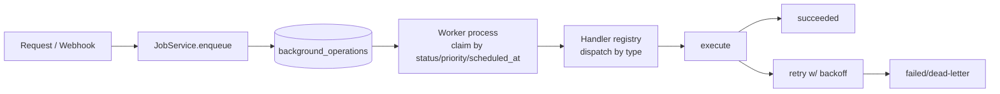
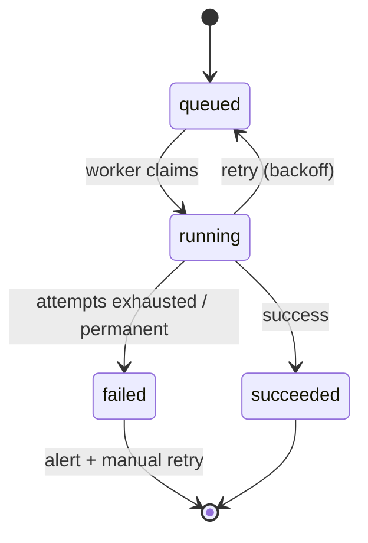
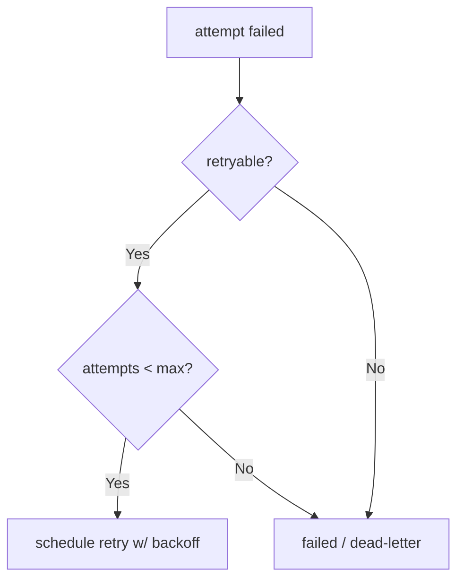

# Background Jobs

**Status:** Architecture design (Phase 2)
**Last updated:** 2026-11-26

---

## 1. Purpose

A durable, idempotent job system for work that should not block the request path: GitHub import/refresh, heavy rendering/export, README PR publishing, webhook processing, retention purge, and email.

## 2. Architecture

- **Single Postgres table** (`background_operations`) as the queue. No external queue service for the MVP.
- **Worker process** (separate process role from the web process) polls/claims jobs.
- **Handler registry:** domain modules register handlers by `type`; the worker dispatches. This keeps `jobs` free of domain imports (avoids cycles, per `MODULE_BOUNDARIES.md`).

## 3. Job lifecycle

## 4. Job fields & behavior

- `type`: e.g., `github.import`, `render.readme`, `publish.readme`, `webhook.process`, `retention.purge`.
- `payload`: typed JSON input.
- `status`: `queued | running | succeeded | failed | cancelled`.
- `attempts` / `max_attempts`: bounded retries.
- `idempotency_key`: unique; prevents duplicate execution.
- `priority`: higher = sooner.
- `scheduled_at`: for delayed/retry jobs.
- `worker_id`: which worker processed it (for debugging).
- `error`: last error (sanitized, no secrets).

## 5. Idempotency

- Every job that can be duplicated (import, publish, export, webhook) carries an idempotency key.
- Enqueue checks the key; a duplicate returns the existing job.
- Handlers must be **re-entrant**: running the same job twice yields the same result (no duplicate PRs, no double webhook processing).

## 6. Retry & backoff

- Retryable failures (rate limits, transient upstream errors) → backoff (exponential with jitter), bounded by `max_attempts`.
- Permanent failures (validation, permission denied) → `failed` immediately.
- Dead-letter: jobs that exhaust attempts remain `failed` for inspection and manual retry.

## 7. Claim & concurrency

- Workers claim jobs atomically (e.g., `UPDATE ... SET status='running', worker_id=? WHERE id IN (SELECT ... WHERE status='queued' ORDER BY priority, scheduled_at LIMIT n) RETURNING ...`).
- Multiple workers can run; claims are race-safe via the status update.
- **NEEDS VERIFICATION:** optimal claim interval and batch size under expected load.

## 8. Job types (MVP)

| Type | Trigger | Notes |
|---|---|---|
| `github.import` | user import / refresh | rate-limit aware, idempotent |
| `render.readme` / `render.portfolio` | export / publish | deterministic render |
| `publish.readme` | publication approval | creates PR, idempotent |
| `webhook.process` | GitHub webhook | idempotent via event id |
| `retention.purge` | scheduled | data retention |
| `email.send` | notifications | provider dependency |

## 9. Status exposure

- `GET /api/jobs/:id` exposes status (owner-scoped).
- The UI polls on long operations (import, publish) or subscribes to completion.

## 10. Failure & recovery

- On worker crash, `running` jobs are re-queued (stale-claim reaper) after a timeout.
- Jobs are durable (Postgres) → no lost work on restart.
- See `DISASTER_RECOVERY.md`.

## 11. Scaling

- The Postgres queue is adequate for MVP. If volume/latency grows, swap the queue for a dedicated service (e.g., QStash/Inngest/BullMQ+Redis) behind the same `JobService` interface. **Justification required before introducing it.**

## 12. Related

- `DATABASE_SCHEMA.md` — `background_operations`.
- `GITHUB_INTEGRATION.md` — publish/webhook jobs.
- `DISASTER_RECOVERY.md` — recovery of in-flight jobs.
