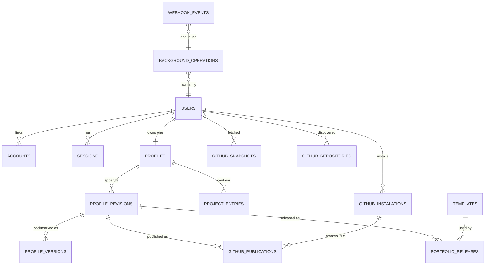

# Database Schema

**Status:** Architecture design (Phase 2) — schema for review, not yet migrated
**Last updated:** 2026-11-26

Complete relational design for PostgreSQL via Drizzle. UUIDs are used for all public-facing identifiers. Imported GitHub facts are stored **separately** from user-authored profile data. **No billing tables** (no approved monetization requirement).

---

## 0. Conventions

- Primary keys: `id uuid DEFAULT gen_random_uuid() PRIMARY KEY`.
- Timestamps: `timestamptz`, set via trigger/app default.
- Soft delete: `deleted_at timestamptz NULL`.
- Enums: `text` with `CHECK` constraints (portable, migration-friendly).
- All user-owned rows carry `user_id uuid NOT NULL REFERENCES users(id)`.
- Retention: soft-delete then purge job (see `DATABASE_ARCHITECTURE.md` §6).

## 1. Entity-relationship diagram



## 2. DDL (illustrative PostgreSQL)

> TypeScript/SQL examples inside Markdown specifications are permitted. This DDL is the design, not a migration script.

```sql
-- ---- identity & auth ----
CREATE TABLE users (
  id            uuid PRIMARY KEY DEFAULT gen_random_uuid(),
  email         text NOT NULL UNIQUE,
  display_name  text,
  avatar_url    text,
  locale        text NOT NULL DEFAULT 'en',
  created_at    timestamptz NOT NULL DEFAULT now(),
  updated_at    timestamptz NOT NULL DEFAULT now(),
  deleted_at    timestamptz
);

CREATE TABLE accounts (
  id               uuid PRIMARY KEY DEFAULT gen_random_uuid(),
  user_id          uuid NOT NULL REFERENCES users(id) ON DELETE CASCADE,
  provider         text NOT NULL,               -- 'github' | 'email' | 'google'
  provider_account_id text NOT NULL,            -- external subject
  provider_user_id   text,                      -- github numeric id (nullable)
  scopes           text[] NOT NULL DEFAULT '{}',
  created_at       timestamptz NOT NULL DEFAULT now(),
  updated_at       timestamptz NOT NULL DEFAULT now(),
  UNIQUE (provider, provider_account_id)
);

CREATE TABLE sessions (
  id            uuid PRIMARY KEY DEFAULT gen_random_uuid(),
  user_id       uuid NOT NULL REFERENCES users(id) ON DELETE CASCADE,
  token_hash    text NOT NULL UNIQUE,           -- hash of opaque session token
  expires_at    timestamptz NOT NULL,
  last_used_at  timestamptz,
  user_agent    text,
  ip            text,
  revoked_at    timestamptz,
  created_at    timestamptz NOT NULL DEFAULT now()
);
CREATE INDEX idx_sessions_user ON sessions(user_id);

-- ---- canonical profile & versions ----
CREATE TABLE profiles (
  id                 uuid PRIMARY KEY DEFAULT gen_random_uuid(),
  user_id            uuid NOT NULL UNIQUE REFERENCES users(id) ON DELETE CASCADE,
  schema_version     int  NOT NULL DEFAULT 1,
  slug               text,                       -- optional public handle
  current_revision_id uuid REFERENCES profile_revisions(id),
  published_revision_id uuid REFERENCES profile_revisions(id),
  status             text NOT NULL DEFAULT 'draft'
                      CHECK (status IN ('draft','published')),
  created_at         timestamptz NOT NULL DEFAULT now(),
  updated_at         timestamptz NOT NULL DEFAULT now(),
  deleted_at         timestamptz
);

CREATE TABLE profile_revisions (
  id               uuid PRIMARY KEY DEFAULT gen_random_uuid(),
  profile_id       uuid NOT NULL REFERENCES profiles(id) ON DELETE CASCADE,
  revision_number  int  NOT NULL,
  document         jsonb NOT NULL,               -- validated ProfileDocument
  revision_kind    text NOT NULL DEFAULT 'draft'
                    CHECK (revision_kind IN ('draft','snapshot','export')),
  source           text NOT NULL DEFAULT 'manual'
                    CHECK (source IN ('manual','autosave','import','snapshot','export','publish','rollback')),
  change_summary   text,
  author_user_id   uuid REFERENCES users(id),
  parent_revision_id uuid REFERENCES profile_revisions(id),
  created_at       timestamptz NOT NULL DEFAULT now(),
  UNIQUE (profile_id, revision_number)
);
CREATE INDEX idx_revisions_profile_created
  ON profile_revisions(profile_id, created_at DESC);

CREATE TABLE profile_versions (
  id            uuid PRIMARY KEY DEFAULT gen_random_uuid(),
  profile_id    uuid NOT NULL REFERENCES profiles(id) ON DELETE CASCADE,
  revision_id   uuid NOT NULL REFERENCES profile_revisions(id) ON DELETE CASCADE,
  title         text,
  version_label text NOT NULL,
  created_by    uuid REFERENCES users(id),
  created_at    timestamptz NOT NULL DEFAULT now(),
  UNIQUE (profile_id, version_label)
);
CREATE INDEX idx_versions_profile ON profile_versions(profile_id);

-- ---- github imported data (separate from authored) ----
CREATE TABLE github_snapshots (
  id               uuid PRIMARY KEY DEFAULT gen_random_uuid(),
  user_id          uuid NOT NULL REFERENCES users(id) ON DELETE CASCADE,
  provider_account_id text,
  source_type      text NOT NULL
                    CHECK (source_type IN ('profile','repositories')),
  source_id        text,                          -- github user id / login
  payload          jsonb NOT NULL,                 -- raw fetched data
  etag             text,                           -- for conditional refresh
  fetched_at       timestamptz NOT NULL DEFAULT now()
);
CREATE INDEX idx_snapshots_user_type ON github_snapshots(user_id, source_type);

CREATE TABLE github_repositories (
  id               uuid PRIMARY KEY DEFAULT gen_random_uuid(),
  user_id          uuid NOT NULL REFERENCES users(id) ON DELETE CASCADE,
  owner            text NOT NULL,
  name             text NOT NULL,
  full_name        text NOT NULL,
  default_branch   text,
  description      text,
  language         text,
  stargazers_count int,
  forks_count      int,
  html_url         text,
  selected         boolean NOT NULL DEFAULT false,
  snapshot_id      uuid REFERENCES github_snapshots(id) ON DELETE SET NULL,
  imported_at      timestamptz NOT NULL DEFAULT now(),
  updated_at       timestamptz NOT NULL DEFAULT now(),
  UNIQUE (user_id, full_name)
);
CREATE INDEX idx_repos_user ON github_repositories(user_id, selected);

CREATE TABLE project_entries (
  id            uuid PRIMARY KEY DEFAULT gen_random_uuid(),
  profile_id    uuid NOT NULL REFERENCES profiles(id) ON DELETE CASCADE,
  user_id       uuid NOT NULL REFERENCES users(id) ON DELETE CASCADE,
  title         text NOT NULL,
  description   text,
  url           text,
  repo_id       uuid REFERENCES github_repositories(id) ON DELETE SET NULL,
  repo_full_name text,
  position      int NOT NULL DEFAULT 0,
  source        text NOT NULL DEFAULT 'authored'
                 CHECK (source IN ('authored','imported')),
  created_at    timestamptz NOT NULL DEFAULT now(),
  updated_at    timestamptz NOT NULL DEFAULT now()
);
CREATE INDEX idx_projects_profile ON project_entries(profile_id, position);

-- ---- templates ----
CREATE TABLE templates (
  id             uuid PRIMARY KEY DEFAULT gen_random_uuid(),
  kind           text NOT NULL
                   CHECK (kind IN ('readme','portfolio')),
  name           text NOT NULL,
  slug           text NOT NULL,
  description    text,
  template_config jsonb NOT NULL,                 -- versioned template config
  schema_version int NOT NULL,
  is_active      boolean NOT NULL DEFAULT true,
  created_at     timestamptz NOT NULL DEFAULT now(),
  UNIQUE (kind, slug)
);

-- ---- publications / releases ----
CREATE TABLE portfolio_releases (
  id            uuid PRIMARY KEY DEFAULT gen_random_uuid(),
  profile_id    uuid NOT NULL REFERENCES profiles(id) ON DELETE CASCADE,
  revision_id   uuid NOT NULL REFERENCES profile_revisions(id) ON DELETE CASCADE,
  template_id   uuid REFERENCES templates(id) ON DELETE SET NULL,
  slug          text NOT NULL,
  is_active     boolean NOT NULL DEFAULT false,
  published_at  timestamptz,
  unpublished_at timestamptz,
  created_at    timestamptz NOT NULL DEFAULT now(),
  UNIQUE (profile_id, slug, revision_id)
);
CREATE INDEX idx_releases_active ON portfolio_releases(slug, is_active);

CREATE TABLE github_installations (
  id             uuid PRIMARY KEY DEFAULT gen_random_uuid(),
  user_id        uuid NOT NULL REFERENCES users(id) ON DELETE CASCADE,
  owner_login    text NOT NULL,
  installation_id text NOT NULL,                  -- github installation id
  permissions    jsonb NOT NULL,
  repository_ids text[] NOT NULL DEFAULT '{}',
  status         text NOT NULL DEFAULT 'active'
                   CHECK (status IN ('active','revoked','expired')),
  created_at     timestamptz NOT NULL DEFAULT now(),
  updated_at     timestamptz NOT NULL DEFAULT now(),
  revoked_at     timestamptz
);

CREATE TABLE github_publications (
  id             uuid PRIMARY KEY DEFAULT gen_random_uuid(),
  profile_id     uuid NOT NULL REFERENCES profiles(id) ON DELETE CASCADE,
  revision_id    uuid NOT NULL REFERENCES profile_revisions(id) ON DELETE CASCADE,
  installation_id uuid REFERENCES github_installations(id) ON DELETE SET NULL,
  repo_owner     text NOT NULL,
  repo_name      text NOT NULL,
  branch         text NOT NULL,
  pr_number      int,
  pr_url         text,
  status         text NOT NULL DEFAULT 'pending'
                   CHECK (status IN ('pending','open','merged','closed','failed')),
  attempt_count  int NOT NULL DEFAULT 0,
  idempotency_key text NOT NULL UNIQUE,           -- prevents duplicate PRs
  created_at     timestamptz NOT NULL DEFAULT now(),
  updated_at     timestamptz NOT NULL DEFAULT now()
);
CREATE INDEX idx_publications_profile ON github_publications(profile_id, created_at DESC);

-- ---- jobs & webhooks ----
CREATE TABLE background_operations (
  id               uuid PRIMARY KEY DEFAULT gen_random_uuid(),
  user_id          uuid REFERENCES users(id) ON DELETE CASCADE,
  type             text NOT NULL,                 -- e.g. 'github.import','publish.readme'
  payload          jsonb NOT NULL,
  status           text NOT NULL DEFAULT 'queued'
                     CHECK (status IN ('queued','running','succeeded','failed','cancelled')),
  attempts         int NOT NULL DEFAULT 0,
  max_attempts     int NOT NULL DEFAULT 5,
  priority         int NOT NULL DEFAULT 0,
  idempotency_key  text UNIQUE,
  scheduled_at     timestamptz NOT NULL DEFAULT now(),
  started_at       timestamptz,
  completed_at     timestamptz,
  worker_id        text,
  error            text,
  created_at       timestamptz NOT NULL DEFAULT now()
);
CREATE INDEX idx_jobs_status ON background_operations(status, priority, scheduled_at);

CREATE TABLE webhook_events (
  id            uuid PRIMARY KEY DEFAULT gen_random_uuid(),
  provider      text NOT NULL,
  event_type    text NOT NULL,
  event_id      text NOT NULL,                    -- provider event id (idempotency)
  payload       jsonb NOT NULL,
  received_at   timestamptz NOT NULL DEFAULT now(),
  processed_at  timestamptz,
  status        text NOT NULL DEFAULT 'received'
                 CHECK (status IN ('received','processed','failed')),
  error         text,
  UNIQUE (provider, event_id)
);
```

## 3. Per-table documentation

### users
- **Purpose:** internal account identity.
- **Columns:** `id` (uuid, PK), `email` (text, unique), `display_name`, `avatar_url`, `locale`, `created_at`, `updated_at`, `deleted_at`.
- **FK:** none. **Unique:** `email`.
- **Indexes:** email (unique).
- **Ownership:** top-level entity.
- **Retention:** soft delete via `deleted_at`; hard delete/purge by retention job.

### accounts
- **Purpose:** linked external auth providers per user (GitHub, email, future).
- **Columns:** `id`, `user_id`, `provider`, `provider_account_id`, `provider_user_id`, `scopes text[]`, timestamps.
- **FK:** `user_id → users(id) ON DELETE CASCADE`.
- **Unique:** `(provider, provider_account_id)`.
- **Ownership:** belongs to a user.
- **Retention:** cascade on user deletion.

### sessions
- **Purpose:** opaque, revocable server-side sessions.
- **Columns:** `id`, `user_id`, `token_hash` (unique), `expires_at`, `last_used_at`, `user_agent`, `ip`, `revoked_at`, `created_at`.
- **FK:** `user_id → users(id) ON DELETE CASCADE`.
- **Unique:** `token_hash`.
- **Index:** `(user_id)`.
- **Ownership:** belongs to a user.
- **Retention:** expired/revoked sessions purged on schedule; hard delete on user purge. **Never store raw tokens.**

### profiles
- **Purpose:** the single canonical profile per user; pointers to current/published revisions.
- **Columns:** `id`, `user_id` (unique), `schema_version`, `slug`, `current_revision_id`, `published_revision_id`, `status`, timestamps, `deleted_at`.
- **FK:** `user_id → users(id) ON DELETE CASCADE`; `current_revision_id`/`published_revision_id → profile_revisions(id)`.
- **Unique:** `user_id` (one profile per user).
- **Ownership:** exactly one per user.
- **Retention:** soft delete; cascade on user purge.

### profile_revisions
- **Purpose:** immutable, append-only revisions of the canonical document (draft autosaves, snapshots, exports).
- **Columns:** `id`, `profile_id`, `revision_number`, `document jsonb`, `revision_kind`, `source`, `change_summary`, `author_user_id`, `parent_revision_id`, `created_at`.
- **FK:** `profile_id → profiles(id) ON DELETE CASCADE`; `author_user_id → users(id)`; `parent_revision_id → profile_revisions(id)`.
- **Unique:** `(profile_id, revision_number)`.
- **Index:** `(profile_id, created_at DESC)` for history.
- **Ownership:** belongs to a profile; the document is the canonical content.
- **Retention:** cascade on profile deletion; purged with user purge. **Immutable** — never updated.

### profile_versions
- **Purpose:** user-created named snapshots/bookmarks ("version history" labels) referencing a revision.
- **Columns:** `id`, `profile_id`, `revision_id`, `title`, `version_label`, `created_by`, `created_at`.
- **FK:** `profile_id → profiles(id)`, `revision_id → profile_revisions(id) ON DELETE CASCADE`, `created_by → users(id)`.
- **Unique:** `(profile_id, version_label)`.
- **Index:** `(profile_id)`.
- **Ownership:** belongs to a profile.
- **Retention:** cascade on profile deletion.

### github_snapshots
- **Purpose:** cached, point-in-time **imported** GitHub data (profile + repos). Distinct from authored data.
- **Columns:** `id`, `user_id`, `provider_account_id`, `source_type`, `source_id`, `payload jsonb`, `etag`, `fetched_at`.
- **FK:** `user_id → users(id) ON DELETE CASCADE`.
- **Index:** `(user_id, source_type)`.
- **Ownership:** belongs to a user; it is a **cache**, not the source of truth for user content.
- **Retention:** stale snapshots purged on schedule; never used to overwrite authored content.

### github_repositories
- **Purpose:** discovered repositories for a user, with selection state.
- **Columns:** `id`, `user_id`, `owner`, `name`, `full_name`, `default_branch`, `description`, `language`, `stargazers_count`, `forks_count`, `html_url`, `selected`, `snapshot_id`, `imported_at`, `updated_at`.
- **FK:** `user_id → users(id) ON DELETE CASCADE`; `snapshot_id → github_snapshots(id) ON DELETE SET NULL`.
- **Unique:** `(user_id, full_name)`.
- **Index:** `(user_id, selected)`.
- **Ownership:** belongs to a user.
- **Retention:** cascade on user deletion.

### project_entries
- **Purpose:** curated project descriptions, optionally linked to a repo (authored or imported).
- **Columns:** `id`, `profile_id`, `user_id`, `title`, `description`, `url`, `repo_id`, `repo_full_name`, `position`, `source`, timestamps.
- **FK:** `profile_id → profiles(id) ON DELETE CASCADE`; `user_id → users(id) ON DELETE CASCADE`; `repo_id → github_repositories(id) ON DELETE SET NULL`.
- **Index:** `(profile_id, position)`.
- **Ownership:** belongs to a profile/user. `source` distinguishes authored vs imported.
- **Retention:** cascade on profile/user deletion.

### templates
- **Purpose:** registered README/portfolio templates with versioned config and schema compatibility.
- **Columns:** `id`, `kind`, `name`, `slug`, `description`, `template_config jsonb`, `schema_version`, `is_active`, `created_at`.
- **Unique:** `(kind, slug)`.
- **Ownership:** platform-owned (not user-owned).
- **Retention:** retained; inactive templates kept for historical rendering.

### portfolio_releases
- **Purpose:** immutable, published portfolio snapshots tied to a revision.
- **Columns:** `id`, `profile_id`, `revision_id`, `template_id`, `slug`, `is_active`, `published_at`, `unpublished_at`, `created_at`.
- **FK:** `profile_id → profiles(id) ON DELETE CASCADE`; `revision_id → profile_revisions(id) ON DELETE CASCADE`; `template_id → templates(id) ON DELETE SET NULL`.
- **Unique:** `(profile_id, slug, revision_id)`.
- **Index:** `(slug, is_active)` for public delivery.
- **Ownership:** belongs to a profile. Public delivery serves only `is_active = true`.
- **Retention:** cascade on profile deletion; `unpublished_at` records unpublishing.

### github_installations
- **Purpose:** GitHub App installation grants per user/owner (least-privilege repo write access).
- **Columns:** `id`, `user_id`, `owner_login`, `installation_id`, `permissions jsonb`, `repository_ids text[]`, `status`, timestamps, `revoked_at`.
- **FK:** `user_id → users(id) ON DELETE CASCADE`.
- **Ownership:** belongs to a user.
- **Retention:** revoked installations retained for audit; purged on user deletion.

### github_publications
- **Purpose:** README publish-by-PR records, with idempotency and status.
- **Columns:** `id`, `profile_id`, `revision_id`, `installation_id`, `repo_owner`, `repo_name`, `branch`, `pr_number`, `pr_url`, `status`, `attempt_count`, `idempotency_key`, timestamps.
- **FK:** `profile_id → profiles(id) ON DELETE CASCADE`; `revision_id → profile_revisions(id) ON DELETE CASCADE`; `installation_id → github_installations(id) ON DELETE SET NULL`.
- **Unique:** `idempotency_key` (prevents duplicate PRs).
- **Index:** `(profile_id, created_at DESC)`.
- **Ownership:** belongs to a profile.
- **Retention:** cascade on profile deletion.

### background_operations
- **Purpose:** durable, idempotent job queue.
- **Columns:** `id`, `user_id`, `type`, `payload jsonb`, `status`, `attempts`, `max_attempts`, `priority`, `idempotency_key`, `scheduled_at`, `started_at`, `completed_at`, `worker_id`, `error`, `created_at`.
- **FK:** `user_id → users(id) ON DELETE CASCADE` (nullable for system jobs).
- **Unique:** `idempotency_key`.
- **Index:** `(status, priority, scheduled_at)` for claim queries.
- **Ownership:** belongs to a user (or system).
- **Retention:** succeeded/failed jobs retained for observability window then purged.

### webhook_events
- **Purpose:** idempotent log of inbound webhooks.
- **Columns:** `id`, `provider`, `event_type`, `event_id`, `payload jsonb`, `received_at`, `processed_at`, `status`, `error`.
- **Unique:** `(provider, event_id)` (idempotency).
- **Ownership:** system-owned.
- **Retention:** retained for observability window then purged.

## 4. Imported vs authored — summary

| Authored (user-owned, never overwritten by import) | Imported (GitHub cache, resolved with provenance) |
|---|---|
| `profile_revisions.document` | `github_snapshots` |
| `profile_versions` | `github_repositories` |
| `project_entries` (source='authored') | `github_repositories` (discovery) |
| `profiles` metadata | `github_snapshots.payload` |

Import **populates** the document on first import and **flags** fields already authored; it never overwrites. See `PROFILE_DOCUMENT_SPEC.md`.

## 5. Schema review checklist

- [ ] One `profiles` row per user (unique `user_id`).
- [ ] Revisions append-only; unique `(profile_id, revision_number)`.
- [ ] Publication/release rows reference immutable revisions.
- [ ] Idempotency keys on publications and jobs.
- [ ] Webhook idempotency via `(provider, event_id)`.
- [ ] Sessions store token hashes, not raw tokens.
- [ ] Imported data stored separately from authored data.
- [ ] UUIDs for all externally exposed IDs.
- [ ] No billing tables (not justified).
