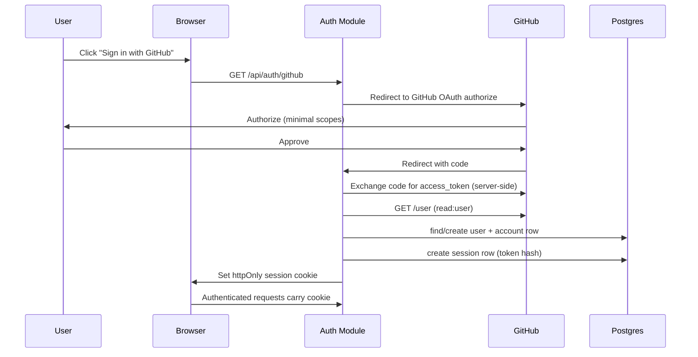
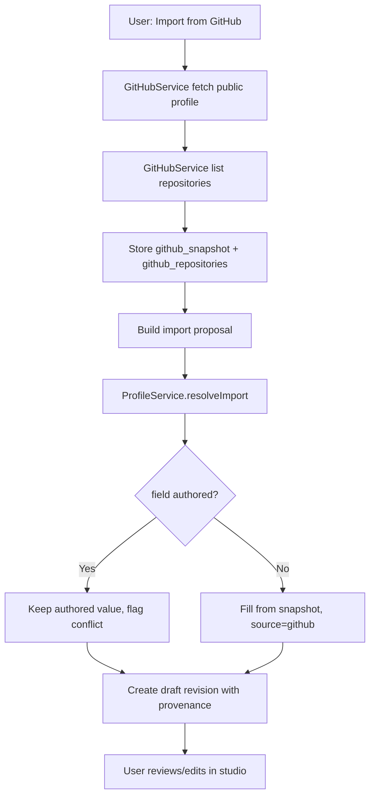
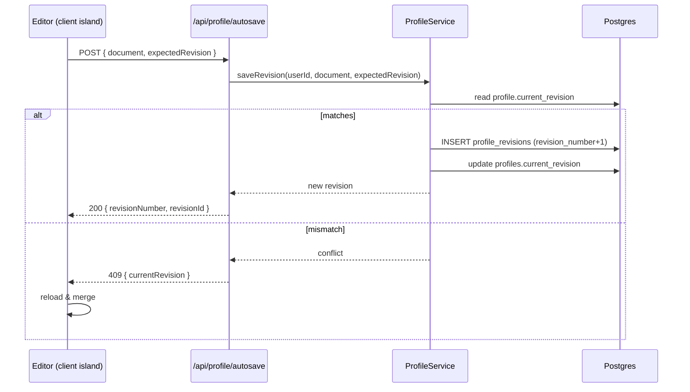
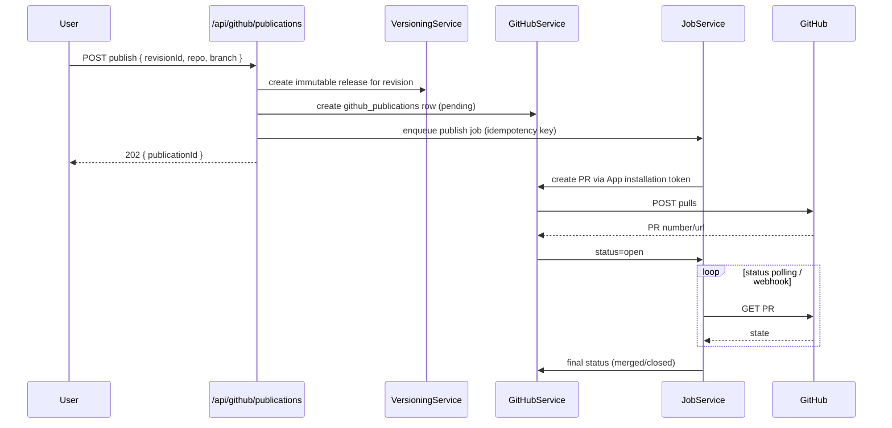
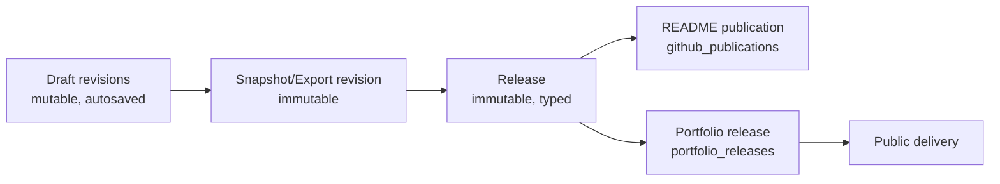
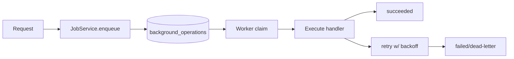

# Data Flow

**Status:** Architecture design (Phase 2)
**Last updated:** 2026-11-26

End-to-end data flows for the platform's critical workflows.

---

## 1. Authentication flow



- The GitHub access token from sign-in is **never** sent to the browser and is **not** used for repo modification.
- Session cookie is opaque, httpOnly, Secure, SameSite=Lax.

## 2. GitHub import flow



**Invariant:** imported data never overwrites authored content. Conflicts are shown to the user.

## 3. Profile editing & autosave flow



## 4. README rendering flow

```mermaid
flowchart LR
    D[ProfileDocument\n(revision)] --> V[Zod validate]
    V --> T[TemplateService.resolve\ntemplate + schema_version]
    T --> M[MarkdownRenderer]
    M --> OUT[README.md string]
    OUT --> PREVIEW[Live preview]
    OUT --> COPY[Copy / Download]
    OUT --> EXPORT[Export revision]
```

Deterministic: same (document, template, options) → same output. Golden tests assert equality.

## 5. Portfolio rendering flow

```mermaid
flowchart LR
    D[ProfileDocument\n(revision)] --> V[Zod validate]
    V --> T[TemplateService.resolve\nportfolio template]
    T --> P[PortfolioRenderer]
    P --> HTML[HTML / ReactNode]
    HTML --> PREVIEW[Live preview]
    HTML --> PUBLISH[Create portfolio release]
    PUBLISH --> PUBLIC[Public delivery route]
```

## 6. GitHub pull-request publishing flow



Idempotency key prevents duplicate PRs on retry. See `GITHUB_INTEGRATION.md`.

## 7. Webhook flow

```mermaid
flowchart TD
    A[GitHub webhook] --> B[Verify signature + event]
    B --> C{valid?}
    C -->|No| D[Reject 401]
    C -->|Yes| E[Store webhook_events with event_id unique]
    E --> F{duplicate?}
    F -->|Yes| G[Skip (idempotent)]
    F -->|No| H[Enqueue job]
    H --> I[Process: update publication/repo state]
```

## 8. Published vs draft data flow



- Drafts are the editing surface.
- Releases are immutable and reference a specific revision.
- Public delivery only ever serves releases, never drafts.

## 9. Background operation data flow



Status is exposed via `/api/jobs/:id`. The UI polls or subscribes.

## 10. Data flow invariants summary

| Invariant | Enforced at |
|---|---|
| One canonical profile per user | `profiles.user_id` unique |
| Imported ≠ authored | `PROFILE_DOCUMENT_SPEC.md` provenance + `resolveImport` |
| Revisions immutable | append-only `profile_revisions` |
| Published immutable & revision-linked | `*_releases` / `github_publications` reference revisions |
| Public serves releases only | `delivery` module reads releases only |
| Secrets server-side | auth/github modules never export tokens to client |
| Deterministic render | pure renderer functions + golden tests |
