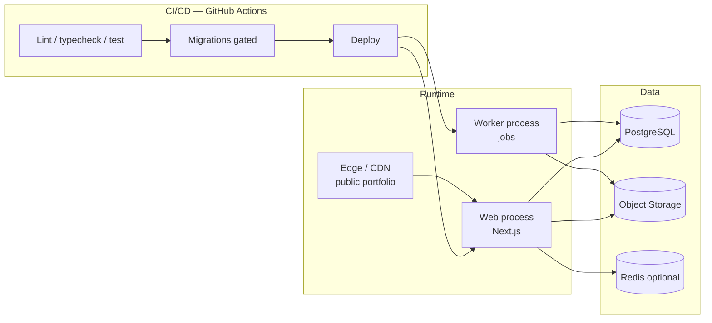
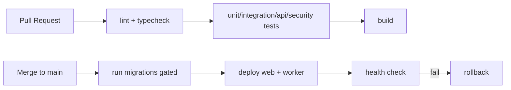

# Deployment Architecture

**Status:** Architecture design (Phase 2)
**Last updated:** 2026-11-26

---

## 1. Deployment model

## 2. Components & hosting

| Component | Hosting | Notes |
|---|---|---|
| Next.js web (UI + Route Handlers + delivery) | Vercel / Node host | **NEEDS VERIFICATION:** pricing, free-tier, India availability |
| Job worker | Same host, separate process role | Scales independently |
| PostgreSQL | Managed Postgres | **NEEDS VERIFICATION:** provider, pricing, free-tier, India region |
| Object storage | S3-compatible | **NEEDS VERIFICATION:** provider, pricing, India |
| Redis (optional) | Managed Redis | Only if profiling justifies |
| Email | Resend / SES | **NEEDS VERIFICATION** |
| Errors/monitoring | Sentry | **NEEDS VERIFICATION** |

## 3. Environments

- **Local:** full app + local Postgres; no real GitHub secrets.
- **Preview (staging):** isolated DB, real-ish GitHub test app, no production data.
- **Production:** isolated DB, real GitHub App, production domains.
- Config via env, validated at startup; fail fast on missing required config.

## 4. CI/CD pipeline

- **PR gate:** lint, typecheck, unit/integration/api/security tests, dependency audit.
- **Deploy:** migrations run as a distinct gated step; if health check fails, roll back.
- **Migrations:** forward-only, reviewed, no destructive change without a rollback plan.

## 5. Runtime process roles

- **Web process:** serves UI, Route Handlers, delivery, and the job *enqueue* side.
- **Worker process:** consumes `background_operations`, executes handlers.
- Both share one codebase and one database; deployed as separate process roles so they scale independently.

## 6. Domains & routing

- App domain (authenticated studios).
- Public portfolio route (`/portfolio/[slug]`) served cacheable at the edge.
- Future custom domains (portfolio) — out of scope for MVP; architecture anticipates routing by slug/domain.

## 7. Environment variables (server-only)

- DB connection, GitHub OAuth client id/secret, GitHub App id/secret + webhook secret, session secret, cookie settings, storage keys, Sentry DSN, email keys, rate-limit config.
- **Never** commit secrets; use a secrets manager/provider env. `.env.example` documents keys.

## 8. Scaling

- Scale web horizontally; scale worker horizontally; Postgres scales vertically then read replicas if needed.
- Edge caching absorbs public portfolio traffic.
- **NEEDS VERIFICATION:** provider-specific scaling limits and India capacity.

## 9. Related

- `OBSERVABILITY.md`
- `DISASTER_RECOVERY.md`
- `BACKGROUND_JOBS.md`
