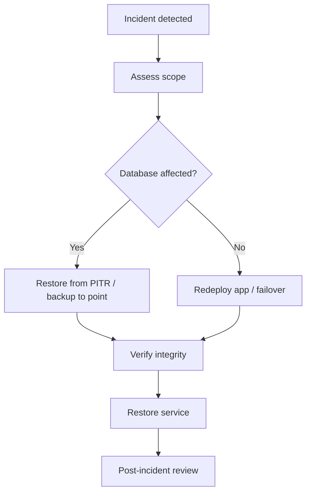

# Disaster Recovery

**Status:** Architecture design (Phase 2)
**Last updated:** 2026-11-26

---

## 1. Objectives

- **RPO (Recovery Point Objective):** how much data loss is acceptable.
- **RTO (Recovery Time Objective):** how fast the system must be restored.

**Proposed targets (to be confirmed):**
- RPO: ≤ 15 minutes (continuous backup / PITR where supported).
- RTO: ≤ 1 hour for the application; ≤ 4 hours for full data restore.

**NEEDS VERIFICATION:** managed Postgres backup/PITR capabilities and RPO/RTO of the chosen provider.

## 2. Threats covered

- Database failure/corruption.
- Application/host failure.
- Provider outage.
- Accidental data deletion (user or admin).
- Credential/secret compromise.
- GitHub dependency outage.

## 3. Data durability

- **PostgreSQL:** managed continuous backup + PITR; regular restore tests.
- **Object storage:** provider versioning for exports.
- **Revisions are append-only:** the full profile history is preserved, enabling recovery to any prior revision.
- **Published releases are immutable:** a published portfolio/README remains recoverable from its revision.

## 4. Recovery strategies

### 4.1 Database recovery
- Restore to a point in time (PITR) on a fresh instance.
- Replay/verify; promote to production.
- Validate migrations and data integrity.

### 4.2 Application recovery
- Redeploy the last known-good release; roll back if a bad deploy caused the incident.
- Health-gated deploys reduce bad-deploy risk.

### 4.3 Job recovery
- `background_operations` is durable; on restart, stale `running` jobs are re-queued by the reaper.
- Idempotent handlers ensure safe re-execution.

### 4.4 GitHub dependency outage
- Serving cached snapshots/releases keeps published portfolios available.
- Import/publish degrades gracefully (queue + retry); users see a clear "GitHub unavailable" state.
- No data loss: work is durable in the job queue.

## 5. Secrets & credential compromise

- Rotate affected secrets (OAuth, App, webhook secret, session secret, DB credential).
- Revoke compromised GitHub App installations; sessions are revocable server-side.
- Trigger audit of recent publications/webhooks for unauthorized activity.
- **Incident response:** contain, rotate, audit, notify affected users if required.

## 6. Accidental deletion

- **Soft delete + retention:** user deletion is soft; purge is a scheduled, auditable job.
- **Revision history:** profile edits are append-only → recoverable.
- **Restore from backup** if a destructive operation occurs.

## 7. Incident response

- Detection via `OBSERVABILITY.md` alerts.
- Escalation to the on-call owner.
- Runbook: assess → contain → recover → verify → post-mortem.
- Document lessons learned as ADRs/updated docs.

## 8. Backup testing

- **Restore tests** on a schedule (not just backup creation): verify a backup can be restored and the app works against it.
- **DR drill** periodically to validate RTO/RPO.

## 9. Related

- `DATABASE_ARCHITECTURE.md` §7 (backups & durability)
- `BACKGROUND_JOBS.md` §10 (job recovery)
- `OBSERVABILITY.md` (alerting)
- `SECURITY_ARCHITECTURE.md` (threats)
