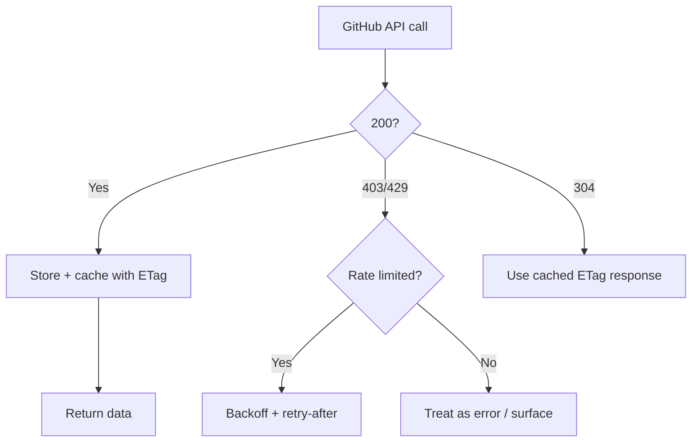
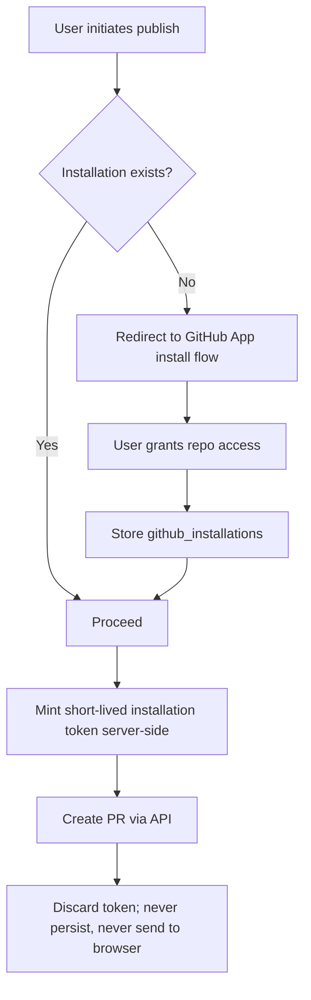
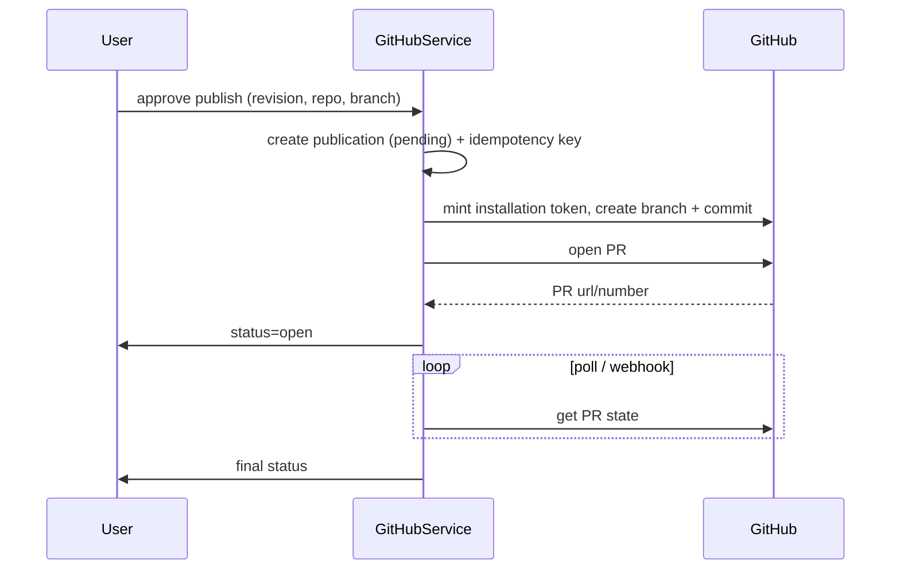

# GitHub Integration

**Status:** Architecture design (Phase 2)
**Last updated:** 2026-11-26

All GitHub access is **server-side**. Tokens and installation credentials never reach the browser. GitHub **sign-in** (identity) is strictly separated from permission to **modify repositories** (publishing).

---

## 1. Two distinct GitHub relationships

| Relationship | Purpose | Mechanism | Scope |
|---|---|---|---|
| **Sign-in** | Identify the user | OAuth (Auth.js) | `read:user`, `user:email` (minimal) |
| **Publishing** | Create PRs to a repo | GitHub App installation | scoped, per-installation, revocable |

**Critical rule:** A signed-in user has **no** repository write permission by default. Publishing requires an explicit GitHub App installation grant.

## 2. Public profile lookup

- Fetch the public profile + email (if public) for a GitHub login.
- Use the **unauthenticated/public** REST API where possible (lower rate-limit pressure, no token required).
- Store the result in `github_snapshots` (source_type='profile') with `etag` for conditional refresh.
- **NEEDS VERIFICATION:** unauthenticated GitHub rate limits (60 req/hr) and behavior for the target volume; a minimal token or GraphQL may be needed for heavier use.

## 3. Repository discovery

- List a user's public repositories via the API.
- Normalize into `github_repositories` rows (unique `(user_id, full_name)`).
- Support selection (`selected` flag) and pagination.
- **NEEDS VERIFICATION:** pagination limits and rate-limit budget.

## 4. API rate-limit handling

- Honor `X-RateLimit-*` headers and `Retry-After`.
- Use **conditional requests** (`If-None-Match` / `If-Modified-Since`) to conserve quota.
- **Cache aggressively** (see `CACHING_STRATEGY.md`).
- Degrade gracefully: if rate-limited, serve cached data and queue a refresh job.

## 5. Caching

- `github_snapshots` = durable cache (payload + etag + fetched_at).
- Hot cache (Redis, optional) for repeated reads within a short TTL.
- Refresh only when stale (TTL or explicit user action).
- See `CACHING_STRATEGY.md`.

## 6. Snapshot storage

- Raw GitHub responses stored in `github_snapshots.payload` (JSONB) and referenced by `github_repositories.snapshot_id`.
- Snapshots are **caches**, not the source of truth for user content.
- Large payloads: consider object storage if a snapshot exceeds a size threshold (configurable); **NEEDS VERIFICATION** on typical payload sizes.

## 7. Refresh behavior

- Manual refresh: re-fetch and update snapshot, then run import resolution (which never overwrites authored fields).
- Automatic refresh: on a TTL, or triggered by a webhook (`push`, `repository` events) — always via a background job.
- Refresh is idempotent and rate-limit-aware.

## 8. GitHub OAuth (sign-in)

- Auth.js GitHub provider with minimal scopes.
- The OAuth access token is used **only** server-side to fetch the user's public profile/email at sign-in; it is **not** persisted long-term and **not** used for repo writes.
- Store only the linked `accounts` row (provider + provider_account_id).

## 9. GitHub App installation (publishing)

- The **GitHub App** (not OAuth, not PAT) provides least-privilege, per-installation, revocable access.
- Installation tokens are **short-lived**, minted on demand, used once per operation, and **never stored or exposed**.
- **NEEDS VERIFICATION:** GitHub App creation, billing, permissions model, rate limits, and installation UX. Creating a GitHub App is an external setup action (not performed in this phase).

## 10. Repository ownership verification

- Before publishing, verify the user's installation grants write access to the target repo (`repo` or `contents: write` scoped to the installation's selected repos).
- Verify the repo belongs to the installation's `repository_ids`.
- Never publish to a repo the installation cannot access.
- Cross-check `repo_owner` against the installation's `owner_login`.

## 11. Pull request publishing

- Render the README from the chosen **revision** (immutable).
- Commit to a branch (e.g., `gitfront/readme-<revisionId>`) and open a PR.
- Idempotency: `github_publications.idempotency_key` unique → retries cannot create duplicate PRs.
- Track PR status: `pending → open → merged | closed | failed`.
- Only merged PRs mark the publication as successful.
- The PR body references the revision and includes a review note; publishing is **reviewed** by the user (explicit approval before opening the PR).

## 12. Webhook processing

- GitHub sends webhooks (e.g., PR state changes) to a server-side endpoint.
- **Verify signature** (GitHub `X-Hub-Signature-256`) using the webhook secret; reject invalid signatures (401).
- Validate `X-GitHub-Event` and `X-GitHub-Delivery`.
- Store in `webhook_events` with unique `(provider, event_id)` for idempotency.
- Enqueue a job for processing; replay-safe.
- **CSRF/replay:** signature + event-id idempotency prevent spoofing and replay.

## 13. Token security

| Token | Lifetime | Storage | Exposure |
|---|---|---|---|
| OAuth access token (sign-in) | Short | Not persisted (fetch profile at sign-in only) | Server-side only |
| GitHub App installation token | Very short (minutes) | Never persisted | Server-side only, single use |
| Session cookie | Configurable | Hash in `sessions` | httpOnly cookie |

- **Never** log tokens, never put them in URLs/client state, never send to the browser.
- Secret scanning in CI to catch accidental token leakage.

## 14. Failure & retry

- Rate-limit → backoff + queue.
- Transient GitHub errors → retry with backoff (bounded attempts).
- PR creation → idempotent retry (no duplicate PRs).
- Webhook processing → idempotent, retryable via jobs.
- See `BACKGROUND_JOBS.md` and `DISASTER_RECOVERY.md`.

## 15. GitHub integration checklist

- [ ] Sign-in OAuth scopes minimal; no repo access from sign-in.
- [ ] Publishing via App installation, not OAuth/PAT.
- [ ] Installation tokens short-lived, server-side only, never persisted.
- [ ] Rate-limit handling (headers, Retry-After, conditional requests).
- [ ] Caching + ETag.
- [ ] Snapshots stored separately from authored data.
- [ ] Import resolution never overwrites authored content.
- [ ] Ownership verification before publish.
- [ ] PR idempotency (no duplicate PRs on retry).
- [ ] Webhook signature verification + idempotency.
- [ ] No tokens in client/logs/URLs.
- [ ] GitHub App creation & limits: NEEDS VERIFICATION.
