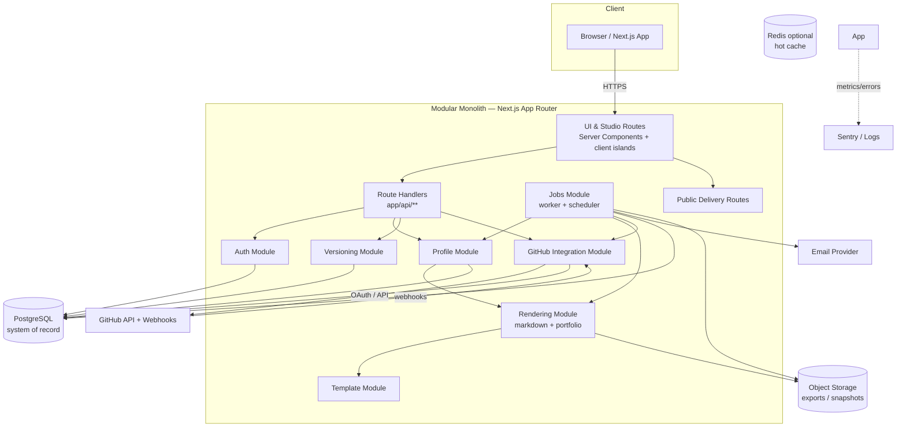
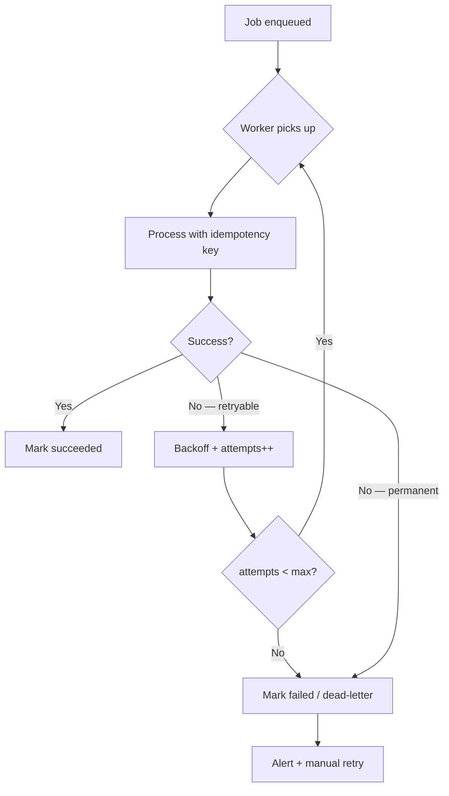

# High-Level Architecture

**Status:** Architecture design (Phase 2)
**Last updated:** 2026-11-26

---

## 1. Architecture at a glance

A **modular monolith** deployed as a single Next.js (App Router) application, backed by a single **PostgreSQL** database, with **server-side** GitHub integration and a **Postgres-backed** background job worker. Object storage holds exported artifacts. Public portfolio pages are served from the same app via cacheable, read-only routes.



## 2. Container / deployable view

```mermaid
flowchart LR
    subgraph Edge[Edge / CDN]
        CDN[Public Portfolio Routes\ncached, read-only]
    end

    subgraph AppHost[Application Host (Vercel / Node)]
        WR[Next.js Web Process\nUI + Route Handlers + Delivery]
        WK[Job Worker Process\nbackground_operations consumer]
    end

    subgraph Data[Data Layer]
        PG[(PostgreSQL)]
        RD[(Redis — optional)]
        OB[(Object Storage)]
    end

    subgraph External[External]
        GITHUB[GitHub]
        MAIL[Email]
    end

    CDN --> WR
    WR --> PG
    WR --> RD
    WR --> OB
    WR --> GITHUB
    WK --> PG
    WK --> GITHUB
    WK --> MAIL
    WK --> OB
```

Two process roles (web and worker) share one codebase and one database. They may run as separate processes/instances of the same deployable.

## 3. Request lifecycle (typical)

1. Browser requests a page or API route.
2. Edge/CDN serves cached public portfolio routes where applicable.
3. Next.js Route Handler / Server Component resolves the session (auth module).
4. Authorization check (object-level: user owns the profile/publication).
5. Domain module performs the operation against PostgreSQL via Drizzle.
6. For async work (import, render, publish), a job is enqueued; the request returns immediately with a job reference.
7. The job worker processes the job, interacts with GitHub/object storage, updates state.
8. The client polls or is notified of job/publication status.

## 4. Module grouping (logical)

| Module | Responsibility | Primary deps |
|---|---|---|
| `auth` | Login, sessions, accounts, authorization primitives | DB, config |
| `profile` | Canonical ProfileDocument, editing, autosave, import resolution | DB, github-integration, validation |
| `rendering` | Markdown + portfolio renderers, determinism | profile (schema), templates |
| `templates` | Template registry + compatibility | profile (schema) |
| `versioning` | Revisions, releases, rollback, exports | DB, profile |
| `github-integration` | OAuth, App installs, import, repo discovery, PR publishing, webhooks | DB, jobs, config |
| `jobs` | Durable job queue, worker, retries | DB |
| `delivery` | Public portfolio serving, robots, metadata | DB, rendering |
| `shared` | Schema (Zod), types, utilities, validation | none (leaf) |

See `MODULE_BOUNDARIES.md` for dependency rules.

## 5. Key architectural invariants

1. **Single canonical profile** — one `profiles` row per user; both studios read/write the same document.
2. **Append-only revisions** — `profile_revisions` never updated after insert.
3. **Imported ≠ authored** — GitHub data lives in `github_snapshots` and is only merged into the document with provenance; never overwrites authored fields.
4. **Published immutability** — published README/portfolio artifacts are tied to an immutable revision.
5. **Server-side secrets** — no GitHub tokens, session secrets, or private keys in client bundles.
6. **Deterministic rendering** — renderers are pure functions of (document, template, options).
7. **Least privilege** — minimal GitHub scopes; App installation for repo writes.

## 6. Failure & retry overview



Idempotency keys on jobs and webhook events prevent duplicate PRs and double-processing. See `BACKGROUND_JOBS.md` and `GITHUB_INTEGRATION.md`.

## 7. Extensibility

- **New renderer** → add a renderer module consuming the same `ProfileDocument`; no change to profile storage.
- **New template** → register in `templates` with a `schema_version`.
- **New auth provider** → add an `accounts` row type; session service abstracts providers.
- **New output target** → extend the publishing module; releases remain immutable.
- **Scale-out** → the web/worker split allows independent scaling; a real queue can replace the Postgres queue when justified.
