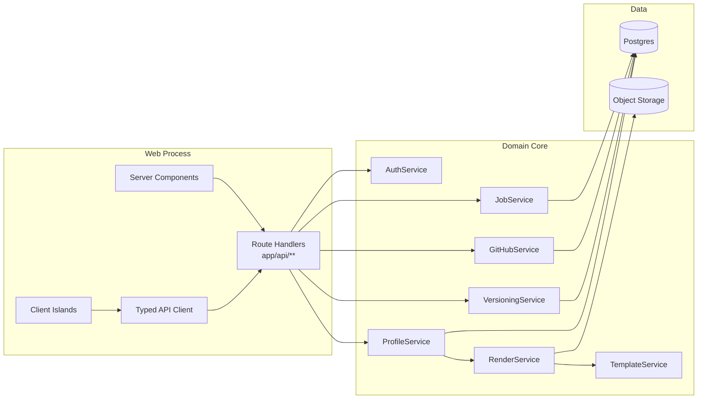
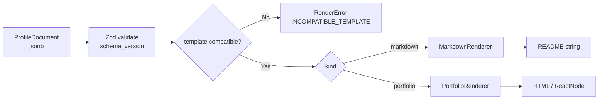
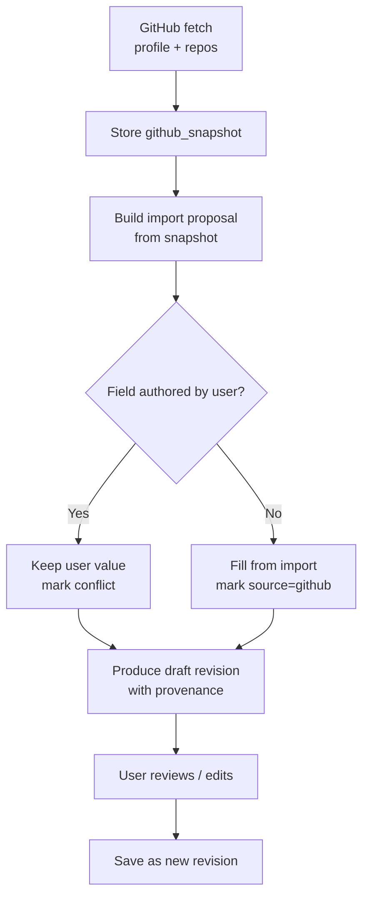
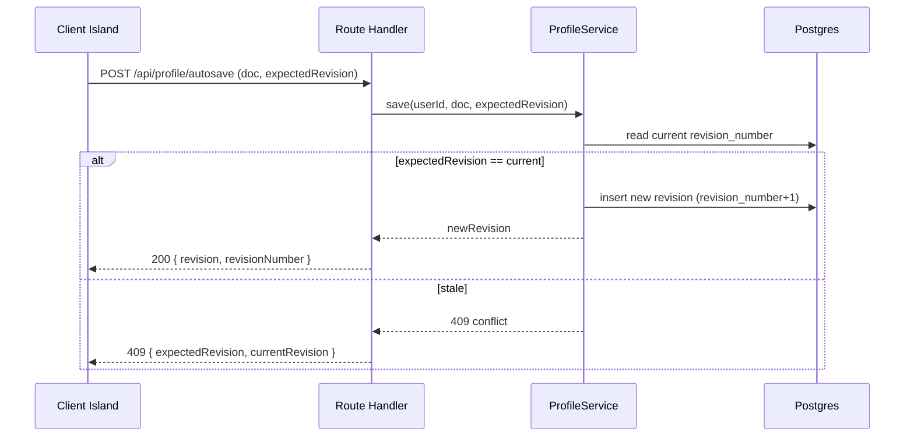
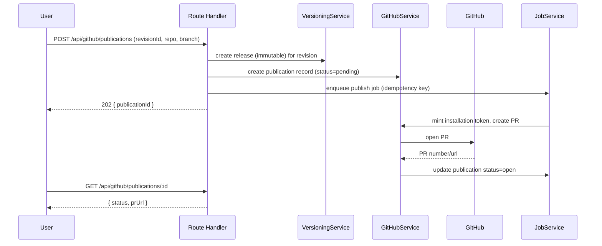

# Low-Level Architecture

**Status:** Architecture design (Phase 2)
**Last updated:** 2026-11-26

This document describes the internal component structure, interfaces, and request/response flows at a component level. It complements `HIGH_LEVEL_ARCHITECTURE.md`.

---

## 1. Component map



## 2. Core services and responsibilities

### 2.1 AuthService
- Issues/validates/revokes sessions.
- Resolves the current `User` and `Account` from the request.
- Provides `requireUser(req)` and `requireOwnership(req, resource)` primitives used by all handlers.
- **No** GitHub repo permission logic here (separated deliberately).

### 2.2 ProfileService
- Creates/loads the single canonical `ProfileDocument` for a user.
- Applies edits as new revisions (autosave + manual).
- Enforces optimistic concurrency (revision number / ETag).
- Resolves GitHub import against user-authored data (import resolution).
- Owns the document schema version and migration.

### 2.3 RenderService
- `renderMarkdown(document, template, options) -> string`
- `renderPortfolio(document, template, options) -> ReactNode / HTML`
- Pure, deterministic, no I/O side effects beyond injected template/data.
- Dispatches to renderer plugins by `kind`.

### 2.4 TemplateService
- Registers/loads templates, validates template↔schema compatibility.
- Returns a resolved template config for a given `schema_version`.

### 2.5 VersioningService
- Creates immutable revisions and releases.
- Handles rollback (creates a new revision from a prior snapshot).
- Handles export (creates an export revision + object storage artifact).

### 2.6 GitHubService
- OAuth sign-in (via Auth.js) and App installation management.
- Public profile lookup, repo discovery, snapshot fetch/refresh.
- Rate-limit handling (caching, ETag, backoff).
- PR creation (via App installation token) and status polling.
- Webhook verification and event dispatch.

### 2.7 JobService
- Enqueues durable jobs with idempotency keys.
- Worker loop: claim, execute, retry, dead-letter.
- Exposes job status to the UI.

## 3. Rendering pipeline (detailed)



Both renderers are **pure**: `render(input) => output`. Determinism is guaranteed by:
- No clocks/random/IDs in output (IDs are deterministic from document fields or passed options).
- Templates resolve assets deterministically.
- External data (imported) is already folded into the validated document before rendering.

## 4. Import resolution pipeline



**Rule:** imported values never overwrite authored fields. Conflicts are surfaced, not silently resolved. See `PROFILE_DOCUMENT_SPEC.md`.

## 5. Save / autosave flow



## 6. Concurrency & conflict model

- Each profile has a monotonic `revision_number` (stored on `profiles` and echoed in each revision).
- Writes carry `expectedRevision`. If it does not match the stored `current_revision`, return `409` with the current revision so the client can merge/retry.
- Autosaves are non-destructive: a rejected stale autosave never mutates state.
- Concurrent editors: last-successful-write-wins on the *revision*, but every write is a new immutable revision, so no edits are lost — the client reconciles against the latest revision.

## 7. Publishing flow (README via PR)



Idempotency key = `publication:{profileId}:{revisionId}:{repo}` so retries cannot create duplicate PRs.

## 8. Interface contracts (internal)

Services communicate through **typed function interfaces** (in-process). Each service exposes a small, explicit API and owns its own data access; no service reads another service's tables directly (except via the owning service).

```ts
// Illustrative (not implementation code)
interface ProfileService {
  getProfile(userId: UserId): Promise<ProfileRecord>;
  saveRevision(input: SaveRevisionInput): Promise<Revision>;
  resolveImport(input: ResolveImportInput): Promise<ImportProposal>;
}
interface RenderService {
  renderMarkdown(input: MarkdownRenderInput): Promise<RenderResult>;
  renderPortfolio(input: PortfolioRenderInput): Promise<RenderResult>;
}
interface GitHubService {
  importProfile(userId: UserId): Promise<ImportResult>;
  createPublication(input: CreatePublicationInput): Promise<Publication>;
  verifyWebhook(headers: Headers, rawBody: string): Promise<WebhookEvent | null>;
}
```

## 9. Data access boundaries

- Each module has a **repository** layer (Drizzle) scoped to its own tables.
- Cross-module reads go through the owning module's service, not by joining tables across modules in another module's repository.
- Transactions span modules only through a single top-level service call (e.g., publishing), which coordinates atomically.

## 10. Configuration

All runtime configuration (DB URL, GitHub OAuth secrets, App ID/secret, Sentry DSN, storage keys) is injected server-side from environment variables. **Nothing secret is read in client components.** Validation of required config at startup fails fast.

## 11. Error model (internal)

A small set of typed errors propagate to Route Handlers and map to the consistent HTTP envelope:

- `ValidationError` → 400
- `AuthError` / `Unauthorized` → 401
- `ForbiddenError` → 403
- `NotFoundError` → 404
- `ConflictError` → 409 (stale revision, duplicate publication)
- `RateLimitedError` → 429
- `GitHubError` / `UpstreamError` → 502/503 with retryability flag
- `InternalError` → 500 (logged, not leaked)

See `API_ARCHITECTURE.md` for the external envelope.
