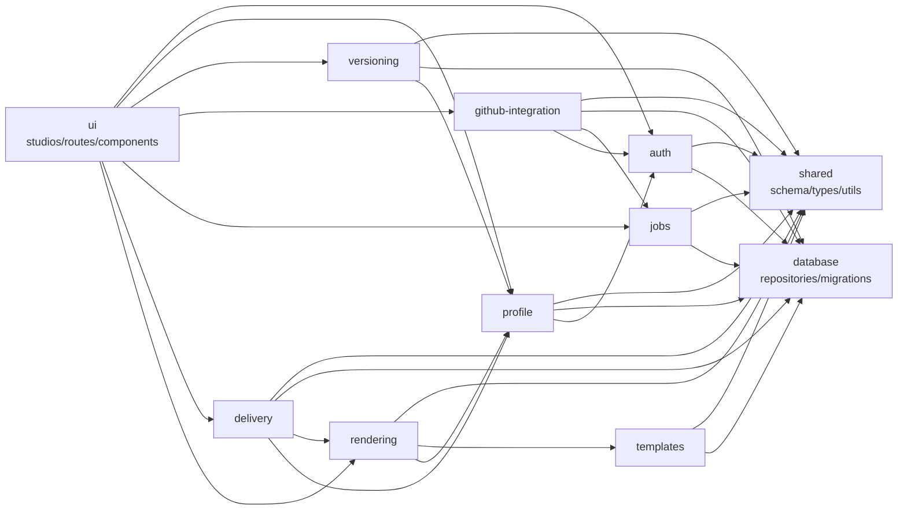

# Module Boundaries

**Status:** Architecture design (Phase 2)
**Last updated:** 2026-11-26

Defines the internal modules of the modular monolith, what each owns, and the **allowed dependency direction**. These rules are enforced by convention and (in CI) by dependency-direction checks.

---

## 1. Module dependency graph

**Leaf (depended-on, depend on nothing internal):** `shared`.

## 2. Module responsibilities & ownership

### shared (leaf)
- `ProfileDocument` Zod schema + TypeScript types + schema versioning.
- Shared validation helpers, ID types, error types, utilities.
- **Must not** import any other domain module.

### database
- Drizzle schema definitions, migrations, connection/transaction primitives.
- Repositories are organized **per-module** but the schema lives centrally.
- No business logic here.

### auth
- Session issuance/validation/revocation, account linking, `requireUser`, `requireOwnership`.
- Owns `users`, `accounts`, `sessions` tables.
- May depend on `shared` and `database`.

### profile
- Canonical `ProfileDocument` lifecycle: create, load, edit, autosave, import resolution, validation.
- Owns `profiles`, `profile_revisions`, `profile_versions`, `project_entries`.
- May depend on `shared`, `database`, `auth` (for ownership), `github-integration` (for import) — but **github-integration must not depend on profile** (avoid cycle: profile depends on github for import; github depends on jobs/auth only).

### templates
- Template registry, schema-version compatibility, template resolution.
- Owns `templates`.
- May depend on `shared`, `database`.

### rendering
- Markdown + portfolio renderers; deterministic; template-driven.
- **No DB access** for the core render functions (pure). May read templates via `templates`.
- May depend on `shared`, `templates`, `profile` (schema only).

### versioning
- Revisions, releases, rollback, exports; publication record creation.
- Owns publication/release bookkeeping tables and revision creation.
- May depend on `shared`, `database`, `profile`.

### github-integration
- OAuth, App installs, import, repo discovery, snapshots, PR publishing, webhooks.
- Owns `github_snapshots`, `github_repositories`, `github_installations`, `github_publications`, `webhook_events`.
- May depend on `shared`, `database`, `auth`, `jobs`.
- **Must not** depend on `profile` (import is initiated by profile; github exposes a service the profile module calls).

### jobs
- Durable queue: enqueue, claim, retry, dead-letter.
- Owns `background_operations`.
- May depend on `shared`, `database`.
- **Must not** import domain logic from profile/github (the worker dispatches via a registered handler registry to avoid circular deps).

### delivery
- Public, read-only portfolio routes; robots/meta; serving published releases.
- May depend on `shared`, `database`, `profile`, `rendering`.
- **Must not** expose private fields; only published releases.

### ui
- Routes, Server Components, client islands, studio pages.
- May depend on all domain modules via their public service interfaces, but **never** directly access DB or secrets.

## 3. Dependency rules (enforced)

1. **No cycles.** Dependency direction must be acyclic.
2. **`shared` is a leaf.** Nothing in `shared` imports a domain module.
3. **Domain modules do not import `ui`.** UI depends on domain, never vice versa.
4. **Rendering core is pure.** The render functions must not import `database`, `auth`, or `ui`. (Renderer *hosting* code may.)
5. **`jobs` does not import domain logic.** The worker uses a handler registry; domain modules register handlers. This keeps the queue generic and prevents cycles.
6. **`github-integration` does not import `profile`.** Import is a profile-initiated operation calling into github-integration.
7. **No cross-module table access.** A module reads/writes only its own tables via its own repository, except through an owning service's public API.
8. **Secrets are server-only.** No module may export secrets to a client boundary.

## 4. Why these boundaries

- **Maintainability:** each module has a clear owner and a small interface.
- **Testability:** pure rendering and isolated services can be unit-tested without the full stack.
- **Avoids duplicate logic:** the canonical document lives once; renderers are separate but not duplicated.
- **Avoids tight coupling between studios:** README and Portfolio are separate renderer modules behind one document; neither studio owns the other's presentation.
- **Extensibility:** new renderers/templates/providers slot in without restructuring.

## 5. Boundary anti-patterns to reject in review

- Two studios each keeping their own copy of profile data.
- Render logic reading from the DB inside a client component.
- `jobs` importing `github-integration` and `profile` directly (use the registry).
- A `shared` module that grows to include business logic (keep it a pure schema/utility leaf).
- Modules reaching into another module's tables via raw queries.
