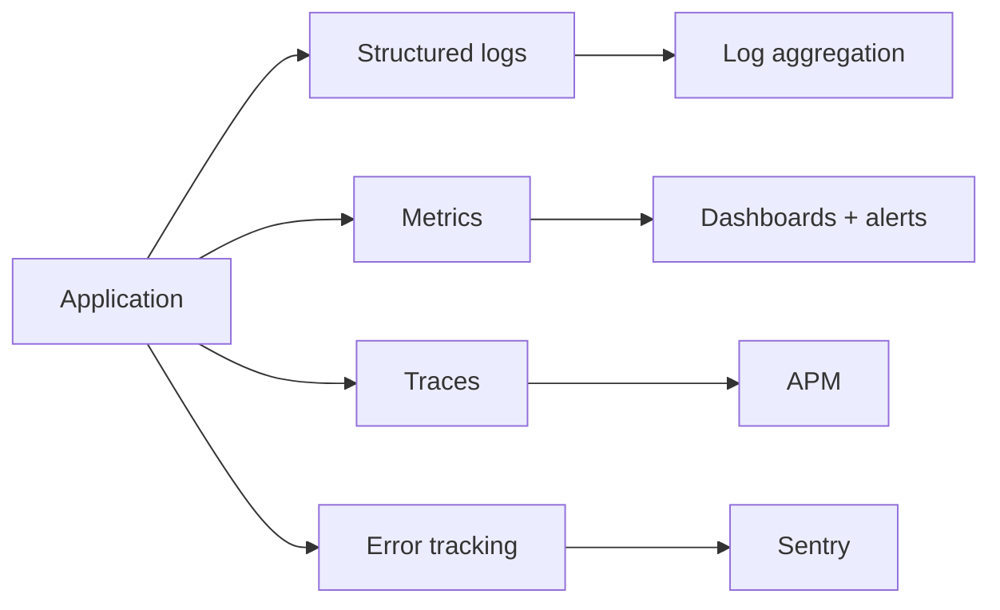

# Observability

**Status:** Architecture design (Phase 2)
**Last updated:** 2026-11-26

---

## 1. Goals

- Know the system is healthy (availability).
- Detect and diagnose errors quickly (errors, performance).
- Understand usage and abuse (rate limits, quotas).
- Support incident response (logs, traces, metrics).

## 2. Pillars

## 3. Logging

- **Structured JSON logs** (timestamp, level, request id, user id (hashed/optional), module, message, error).
- **No secrets/tokens** in logs (enforced by a logging sanitizer + secret scanning).
- Request/response IDs for correlation across web + worker.
- Security-relevant events logged: auth failures, authz denials, webhook rejections, publish events.
- Log retention per provider; **NEEDS VERIFICATION** on retention/quota.

## 4. Metrics

Key metrics (exposed via a lightweight endpoint or provider):
- Request rate, latency (p50/p95/p99), error rate.
- Auth success/failure counts.
- Job queue depth, job success/failure, retry rate.
- GitHub API rate-limit usage / remaining.
- Render latency (preview + published).
- Public portfolio traffic.

**NEEDS VERIFICATION:** metrics provider/quota and India availability.

## 5. Error tracking

- **Sentry** for uncaught errors + performance, with release tracking and dedup.
- Errors are sanitized before sending (no tokens/PII where avoidable).
- Source maps for readable stack traces in production.

## 6. Health checks

- `GET /api/health` (or `/healthz`): liveness (process up) and readiness (DB reachable).
- Used by the deploy platform for health-gated deployment/rollback.

## 7. Alerting

- Alert on: error-rate spikes, auth-failure spikes, job dead-letters, DB connectivity, GitHub rate-limit exhaustion, uptime checks.
- Alert routing to the on-call channel. **NEEDS VERIFICATION** on alerting channel/integration.

## 8. Dashboards

- System overview (requests, errors, latency).
- GitHub integration (import success, rate limits, publish outcomes).
- Jobs (queue depth, failures).
- Public portfolio traffic.

## 9. Privacy in observability

- Minimize PII in logs/metrics; hash user ids where possible; never log document content or tokens.
- Respect retention policies and any applicable privacy law (India DPDP — **NEEDS VERIFICATION** for specifics).

## 10. Related

- `DEPLOYMENT_ARCHITECTURE.md`
- `DISASTER_RECOVERY.md`
- `SECURITY_ARCHITECTURE.md`
