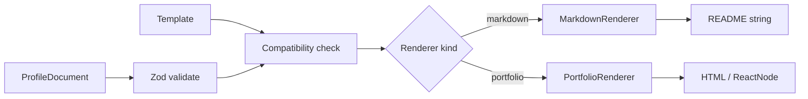
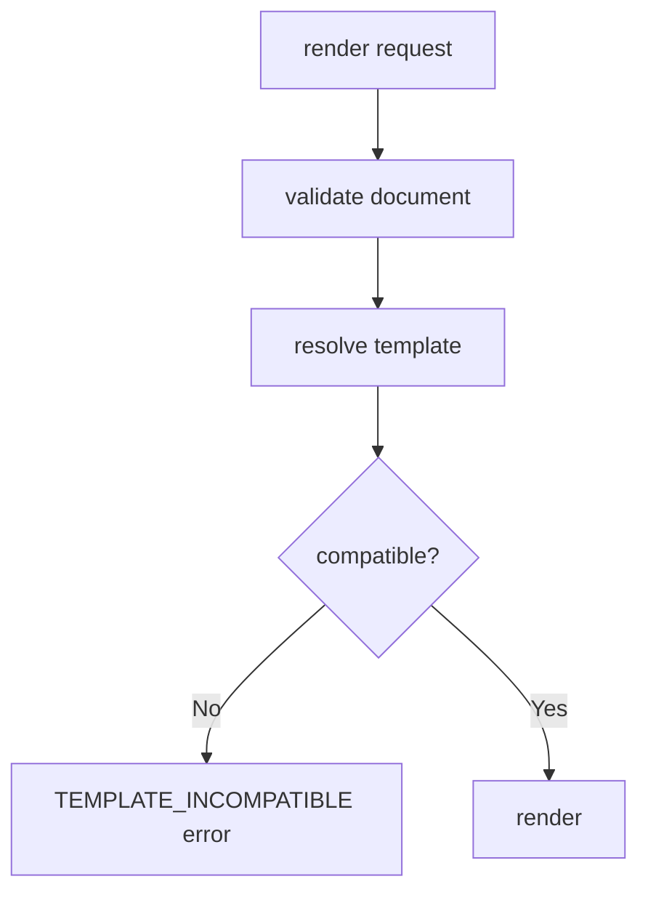

# Rendering Architecture

**Status:** Architecture design (Phase 2)
**Last updated:** 2026-11-26

Both renderers consume the **canonical `ProfileDocument`** and a **template**, and produce **deterministic, testable** output. Rendering is a pure, server-side concern.

---

## 1. Renderer model

- **MarkdownRenderer** → produces a `README.md` string for GitHub.
- **PortfolioRenderer** → produces HTML/React for the portfolio site.
- Both are **pure functions**: `render(document, template, options) => output`.

## 2. Determinism guarantees

1. **No clocks, randomness, or uncontrolled IDs** in output. Any generated IDs are derived deterministically from document fields or passed options.
2. **No external I/O** in the core render functions (templates and data are injected).
3. **Ordering is explicit** via `sectionOrder`; missing keys are handled by a defined fallback (or rejected by template compatibility).
4. **Escaping/sanitization is deterministic** per output type.

These guarantees enable **golden-file tests**: the same input must always produce byte-identical output.

## 3. Canonical input validation

- The `ProfileDocument` is validated by Zod before rendering (`schemaVersion` must be supported).
- Renderers operate only on validated documents.
- Invalid documents are rejected with a validation error; renderers never render unvalidated input.

## 4. Imported-data resolution (before rendering)

Rendering happens **after** import resolution. By the time a document is rendered, imported fields have been folded in with provenance and never overwrote authored fields. See `PROFILE_DOCUMENT_SPEC.md` §7.

## 5. Markdown generation

- Produces a GitHub-compatible `README.md`.
- Applies `readme` config (badges, top languages, layout, section toggles, footer).
- **Security:** sanitize user content to prevent malicious Markdown/HTML (see `SECURITY_ARCHITECTURE.md`). GitHub renders Markdown; we must not inject unsafe HTML/scripts.
- Respects `sectionOrder` and `visibility` (private items excluded unless explicitly included by the user in an explicit export).
- Deterministic badge/language ordering (sorted).

## 6. Portfolio rendering

- Produces HTML (server-side).
- Applies `portfolio` config (layout, section toggles, nav order).
- Applies shared `theme`.
- **Security:** escape all user content; sanitize URLs; never render untrusted HTML.
- **Accessibility:** semantic HTML, ARIA, contrast, keyboard nav (see `TESTING_ARCHITECTURE.md`).
- Respects `visibility`; **private items must never appear** in public output.

## 7. Template registration & compatibility

- Templates are registered in the `templates` table with `kind` (`readme`/`portfolio`), `schema_version`, and `template_config`.
- At render time, the renderer checks template compatibility:
  - Template `schema_version` must be within the renderer's supported range.
  - Template's required features must exist in the document.
- Incompatible → `TEMPLATE_INCOMPATIBLE` error; never a partial/silent render.

## 8. Preview rendering

- **Preview** renders from a given `revisionId` (or the current draft if null) and a template.
- Preview is **read-only** and does not create a release or publication.
- Live preview updates as the editor changes (debounced) by re-rendering on the server.

## 9. Published release rendering

- **Published rendering** renders from an **immutable revision** and is stored/served as a **release**.
- The published output is tied to a specific revision; editing the draft does not change a published release.
- Public delivery serves the rendered release (cached).

## 10. Renderer boundaries

- Renderers are **renderer-module** code; they do not access the DB, auth, or UI.
- They depend on `shared` (schema) and `templates` (resolution).
- Both studios call the same render service with different `kind`/`options`.

## 11. Testing hooks

- Pure functions → unit tests with fixtures.
- Golden tests assert deterministic output for known documents/templates.
- Negative tests assert incompatible templates and private-field exclusion.
- See `TESTING_ARCHITECTURE.md`.
