# Security Architecture

**Status:** Architecture design (Phase 2)
**Last updated:** 2026-11-26

Security is a design concern across every layer. This document performs threat modelling for the platform and defines mitigations and verification tests. **Least privilege** is applied throughout.

---

## 1. Security principles

1. **Least privilege** — minimal GitHub scopes; App-scoped repo writes; DB role limited to the app schema.
2. **Server-side secrets** — tokens, keys, and session secrets never reach the browser.
3. **Defense in depth** — multiple independent controls per threat.
4. **Fail closed** — authz fails when uncertain; never fall back to permissive.
5. **No trust in input** — validate/sanitize everything (document, URLs, markdown, webhooks).
6. **Private by default** — private fields excluded from public output unless explicitly included.
7. **Auditable** — webhooks, publications, and sessions are logged with idempotency/integrity.

## 2. Threat model overview

```mermaid
flowchart LR
    subgraph Threats[Threat surface]
        T1[Auth bypass]
        T2[Object-level authz]
        T3[Cross-account access]
        T4[Token theft]
        T5[SSRF]
        T6[XSS]
        T7[CSRF]
        T8[SQL injection]
        T9[Malicious Markdown]
        T10[Malicious URLs]
        T11[Webhook spoofing]
        T12[Replay]
        T13[Rate-limit abuse]
        T14[Account takeover]
        T15[Public data leakage]
        T16[AI prompt injection]
        T17[Supply chain]
    end
```

---

## 3. Threat catalogue

### 3.1 Authentication bypass
- **Scenario:** Attacker forges/bypasses session validation to access another user's data.
- **Impact:** Full account takeover / data access.
- **Mitigation:** Server-side session validation on every protected route; opaque tokens stored as hashes; `requireUser` enforced in all handlers; no client-side auth decisions; fail closed on invalid sessions.
- **Verification test:** Send requests without/with tampered cookies → expect `401`. Attempt to access a route using a manipulated token → rejected.

### 3.2 Broken object-level authorization (IDOR)
- **Scenario:** Attacker changes a profile/publication/job ID in a request to reference another user's resource.
- **Impact:** Read/edit another user's profile or publications.
- **Mitigation:** Every resource access scoped by `user_id` via `requireOwnership`; queries always filter by owner; UUIDs (non-enumerable); no reliance on client-supplied ownership.
- **Verification test:** As user A, request user B's `profileId`/`publicationId`/`jobId` → expect `403`/`404`. Automated cross-account authz tests.

### 3.3 Cross-account data access
- **Scenario:** A user accesses another account's profile/revisions/releases via shared IDs or cache keys.
- **Impact:** Cross-tenant data leakage.
- **Mitigation:** Single tenant = single user per profile; all queries owner-scoped; no cross-user joins exposed; cache keys include owner/revision (immutable) so no cross-tenant reuse of private content.
- **Verification test:** Two-user test fixtures; assert user A never receives user B's data in any endpoint/cache.

### 3.4 GitHub token theft
- **Scenario:** Attacker extracts a GitHub OAuth token or App installation token and uses it to modify repos.
- **Impact:** Unauthorized repo writes / exfiltration.
- **Mitigation:** Tokens never sent to the browser; OAuth token not persisted (used at sign-in only); App installation tokens short-lived, server-side only, single-use, never logged; secret scanning in CI; tokens excluded from logs and error responses.
- **Verification test:** Assert no token appears in client bundles, network responses, or logs. Assert installation tokens are not persisted. Scan code for token patterns.

### 3.5 SSRF (Server-Side Request Forgery)
- **Scenario:** A user-supplied URL (avatar, website, social link, project URL) is fetched server-side, pointing to internal/metadata endpoints.
- **Impact:** Access to internal services / cloud metadata.
- **Mitigation:** **Avoid server-side fetching of user URLs by default** in the MVP (avatars/links are rendered client-side or stored, not fetched server-side). If any server-side fetch is required, enforce URL allowlist (`http`/`https` only), resolve and reject private/loopback/link-local/metadata IPs, follow redirects with re-validation, and add a network egress allowlist.
- **Verification test:** Submit `http://169.254.169.254/`, `http://127.0.0.1/`, `file://`, and internal hostnames → must be rejected or never fetched server-side.

### 3.6 XSS (Cross-Site Scripting)
- **Scenario:** Malicious script injected via profile content (biography, custom sections, project descriptions) rendered into README/portfolio HTML.
- **Impact:** Session theft, defacement, user compromise.
- **Mitigation:** Context-appropriate escaping in portfolio rendering (escape all user text); sanitize Markdown output (strip/escape raw HTML, scripts, event handlers); never render untrusted HTML; `httpOnly` cookies so stolen JS can't read the session; CSP header on the app.
- **Verification test:** Inject `<script>`, `onerror=`, `` into content → assert output is escaped/sanitized in both renderers. Assert CSP present.

### 3.7 CSRF
- **Scenario:** A malicious site triggers state-changing actions (save, publish, unpublish) using the user's cookie.
- **Impact:** Unauthorized changes.
- **Mitigation:** `SameSite=Lax` cookies; origin/host checks on state-changing Route Handlers; auth checks server-side (not cookie-only trust); CSRF tokens or origin verification for sensitive mutations.
- **Verification test:** Construct cross-site POST requests → expect rejection (origin mismatch).

### 3.8 SQL injection
- **Scenario:** Malicious input injected into SQL via raw query construction.
- **Impact:** Data leakage/destruction.
- **Mitigation:** Drizzle parameterized queries only; **no raw string interpolation**; input validated by Zod before reaching repositories; DB role least-privilege.
- **Verification test:** Inject SQL payloads in all input fields → assert parameterized handling (no error disclosure, no data returned). Static analysis for raw SQL.

### 3.9 Malicious Markdown
- **Scenario:** User content containing unsafe Markdown/HTML (scripts, iframes, data URIs, obfuscated HTML) rendered into README or preview.
- **Impact:** XSS on GitHub/portfolio, phishing, malicious links.
- **Mitigation:** Sanitize Markdown output — strip/escape raw HTML, block `javascript:`/`data:` URLs, restrict/allowlist HTML tags, neutralize event handlers; render preview with the same sanitizer; do not allow raw HTML passthrough.
- **Verification test:** Feed malicious Markdown fixtures → assert sanitized output; assert no raw `<script>`/`on*`/`javascript:` survives.

### 3.10 Malicious URLs
- **Scenario:** User-provided URLs (`javascript:`, `data:`, `vbscript:`, internal IPs) rendered as clickable links.
- **Impact:** XSS, phishing, internal exposure.
- **Mitigation:** Validate URL schemes (`http`/`https` only) at the schema boundary; sanitize on render; relativize/block dangerous schemes; never render `javascript:`/`data:`; link-scanning in tests.
- **Verification test:** Submit dangerous schemes → rejected/sanitized; assert only `http(s)` links render.

### 3.11 Webhook spoofing
- **Scenario:** Attacker sends a fake GitHub webhook to trigger publication/PR actions.
- **Impact:** Unauthorized actions, state corruption.
- **Mitigation:** Verify GitHub signature (`X-Hub-Signature-256`) with the webhook secret; reject invalid signatures (`401`); validate event headers; process via idempotent jobs; webhook endpoint requires no session (signature is the auth).
- **Verification test:** Send webhook with invalid/missing signature → `401`; with valid signature → processed once.

### 3.12 Replay attacks
- **Scenario:** A captured valid webhook/request is replayed to cause duplicate processing.
- **Impact:** Duplicate PRs/processing, state duplication.
- **Mitigation:** Idempotency via unique `(provider, event_id)` in `webhook_events`; idempotency keys on jobs/publications; replayed events are ignored.
- **Verification test:** Replay the same webhook payload/event-id → processed only once; no duplicate PR.

### 3.13 Rate-limit abuse
- **Scenario:** Attacker floods expensive endpoints (import, publish, preview) or abuses GitHub API quota.
- **Impact:** Cost/DoS, quota exhaustion for others.
- **Mitigation:** Per-user/per-IP rate limits; expensive endpoints limited; GitHub API cached + conditional requests + backoff; 429 with `Retry-After`; abuse detection (anomaly on ip/ua).
- **Verification test:** Burst requests beyond limits → `429`; assert backoff on GitHub rate-limit responses.

### 3.14 Account takeover
- **Scenario:** Attacker gains control of a user's account (stolen session, compromised email/GitHub).
- **Impact:** Full account/data compromise, repo publish abuse.
- **Mitigation:** Revocable server-side sessions; revoke on credential change; short session lifetime + rotation; email verification for email flows; anomaly signals (ip/ua); GitHub App installations are revocable independently; least-privilege so a takeover cannot reach other users' data.
- **Verification test:** Simulate session revocation → old session rejected; credential change → sessions revoked.

### 3.15 Public portfolio data leakage
- **Scenario:** Private fields (private email, private projects, private experience) or drafts leak into public portfolio/README output or caches.
- **Impact:** Privacy violation.
- **Mitigation:** `visibility` enforced at the service/delivery boundary; delivery serves only active releases; private items stripped before render and before caching; public routes read-only; draft content never served publicly; tests assert private exclusion.
- **Verification test:** Set items to private → assert absent from preview HTML, public page, and cached output. Assert drafts never publicly accessible.

### 3.16 AI prompt injection and hallucinations
- **Scenario:** If AI features are added, user content or imported data contains prompt-injection instructions that manipulate AI output or leak data.
- **Impact:** Inappropriate/incorrect output, data leakage, reputational harm.
- **Mitigation:** **MVP contains no AI generation** (explicit non-goal). If AI is added later: never place untrusted user content into a privileged system prompt; treat model output as untrusted and sanitize; constrain with structured schemas; human review before publish; log and monitor. Document as a deferred, gated feature.
- **Verification test:** (Deferred) Once AI is added, adversarial prompt-injection test suite; assert no privileged instruction execution and sanitized output.

### 3.17 Dependency & supply-chain risks
- **Scenario:** Malicious or compromised dependency (npm package, model provider) introduces vulnerabilities/backdoors.
- **Impact:** Compromise of the app/data.
- **Mitigation:** Pin/lock dependencies; dependency audit in CI (`npm audit`/equivalent); minimal dependency surface; reviewed dependency changes; lockfile committed; no runtime `eval`/dynamic imports of untrusted code; reproducible builds.
- **Verification test:** CI runs dependency audit on every PR; failing/high-severity deps block merge; lockfile integrity verified.

## 4. Cross-cutting controls

| Control | Applied |
|---|---|
| Least privilege | DB role, GitHub scopes, App installations |
| Secrets management | server-side env; no secrets in client/logs; secret scanning |
| Logging | structured logs, no secrets; security-relevant events logged |
| Encryption | TLS in transit; provider encryption at rest |
| Headers | CSP, X-Content-Type-Options, X-Frame-Options, Referrer-Policy |
| Input validation | Zod at every boundary |
| Output sanitization | Markdown + HTML + URL sanitization |
| Authz | `requireUser` + `requireOwnership` on all owner-scoped endpoints |
| Idempotency | webhooks, jobs, publications |
| Monitoring | Sentry + logs + alerting on auth failures/abuse |

## 5. Verification summary

Every threat has a corresponding test in `TESTING_ARCHITECTURE.md` (security test suite). Security tests run in CI on every PR and as a scheduled suite.

## 6. Related

- `AUTHENTICATION_ARCHITECTURE.md`
- `GITHUB_INTEGRATION.md` §13 (token security)
- `TESTING_ARCHITECTURE.md` (security tests)
- `DISASTER_RECOVERY.md` (incident response)
