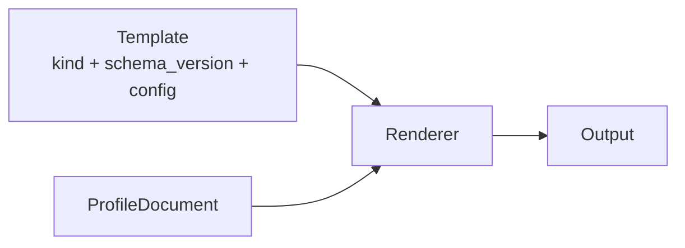
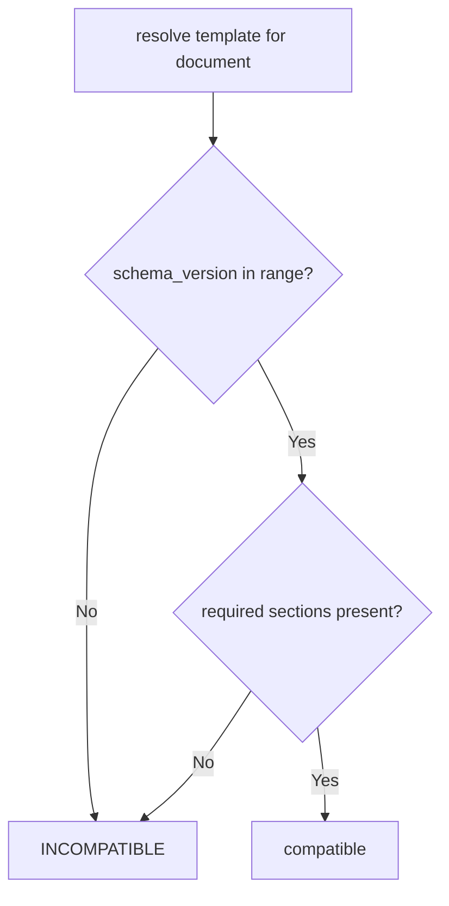

# Template System

**Status:** Architecture design (Phase 2)
**Last updated:** 2026-11-26

Templates define **presentation** for a renderer. They are separate from the canonical document and from renderer logic, enabling multiple templates per studio without changing data.

---

## 1. Template model



- **kind:** `readme` | `portfolio`.
- **schema_version:** the document schema version the template targets.
- **template_config:** versioned JSON config (layout, sections, options).
- **is_active:** whether the template is selectable.

## 2. Template registry

- Templates are stored in the `templates` table (platform-owned, not user-owned).
- Unique `(kind, slug)`.
- Each template has a stable `slug` and a `name`.
- Built-in templates ship with the platform; future template marketplace is out of scope.

## 3. Template config structure (illustrative)

```ts
const ReadmeTemplateConfig = z.object({
  layout: z.enum(['classic','compact','minimal']),
  sections: z.object({
    headline: z.boolean(),
    biography: z.boolean(),
    skills: z.enum(['list','badges']),
    projects: z.boolean(),
    experience: z.boolean(),
    education: z.boolean(),
    certifications: z.boolean(),
    custom: z.array(z.string()), // custom section keys
  }),
  badges: z.object({ themes: z.boolean(), social: z.boolean() }),
  footer: z.boolean(),
});

const PortfolioTemplateConfig = z.object({
  layout: z.enum(['classic','sidebar','grid','minimal','full']),
  nav: z.array(z.string()),
  hero: z.boolean(),
  sections: z.object({
    headline: z.boolean(),
    biography: z.boolean(),
    skills: z.boolean(),
    projects: z.boolean(),
    experience: z.boolean(),
    education: z.boolean(),
    certifications: z.boolean(),
    custom: z.array(z.string()),
  }),
  responsive: z.boolean(),
});
```

## 4. Template compatibility

A template is **compatible** with a document if:

1. `template.schema_version` is within the renderer's supported range.
2. Every section the template requires exists in the document (or is optional).
3. Every `custom` section key referenced exists in `customSections`.

Incompatible templates are rejected with `TEMPLATE_INCOMPATIBLE` (a `400`/`409`), never partially rendered.



## 5. Template resolution

- A document references a template via `readme.templateId` / `portfolio.templateId` (UUID, nullable → default template).
- `TemplateService.resolve(kind, templateId, document)` returns the resolved config + compatibility result.
- Default templates are used when no template is selected.

## 6. Template versioning & evolution

- `schema_version` on the template ties it to a document schema version.
- When the document schema changes (new major version), templates are reviewed and re-targeted or marked inactive.
- Templates are **immutable once released** (a template change is a new version/slug), so published renders remain reproducible.
- Rendering a historical release uses the template version recorded with the release (or a re-render guarded by compatibility).

## 7. Independence between studios

- README templates and portfolio templates are **separate kinds**; they never cross.
- Selecting/changing a README template does not affect portfolio rendering, and vice versa.
- Only the shared `theme` and the shared document content are common.

## 8. Rendering with templates

- The renderer merges: document content + template config + theme → output.
- Template config controls **what** and **how** (sections, layout); the document provides the **data**.
- This separation keeps the document renderer-agnostic.

## 9. Governance

- Templates are reviewed like code (registry + tests + golden renders).
- New templates require: schema compatibility test, golden render, accessibility check (portfolio).
- Deactivated templates remain renderable for historical releases but are not selectable.

## 10. Out of scope

- User-authored custom template authoring in the MVP.
- A public template marketplace.
- AI-generated templates (see security: prompt injection).
