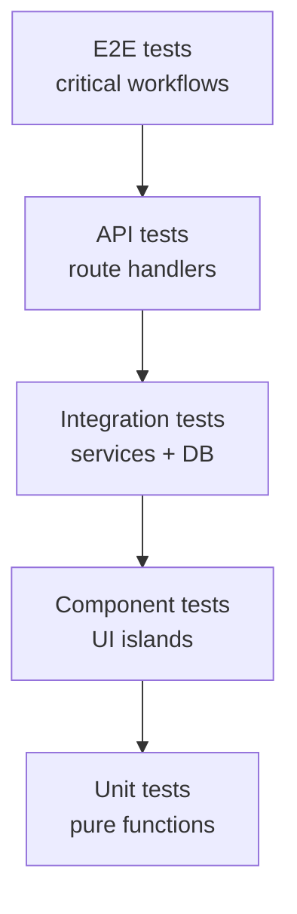

# Testing Architecture

**Status:** Architecture design (Phase 2)
**Last updated:** 2026-11-26

Testing is defined **before implementation**. The strategy covers all required test types and defines scenarios for critical workflows.

---

## 1. Test pyramid

## 2. Test types

### 2.1 Unit tests
- Pure functions: renderers (Markdown/Portfolio), validation (Zod), import resolution, URL/markdown sanitizers, schema migrations, template compatibility.
- Fast, no I/O, deterministic.
- **Key fixtures:** profile documents, templates, GitHub snapshots.

### 2.2 Integration tests
- Services against a real (ephemeral) Postgres: profile save/autosave, revision append, import resolution, versioning, publishing, jobs.
- Use transaction-rollback or ephemeral DB per suite.

### 2.3 API tests
- Route Handlers: status codes, envelope, validation errors, authz (`401`/`403`), idempotency, conflict handling.
- Mock external GitHub at the service boundary.

### 2.4 Database tests
- Schema constraints, unique constraints, FK cascade, migration correctness, retention purge, index behavior on query patterns.

### 2.5 Component tests
- Editor islands, section ordering, preview controls, accessibility.

### 2.6 End-to-end (E2E) tests
- Critical user workflows through the real app (browser or HTTP): sign in, import, edit, preview, export, publish, unpublish, GitHub PR flow (mocked GitHub).

### 2.7 Security tests
- See `SECURITY_ARCHITECTURE.md` threat catalogue. Each threat has a verification test. Run in CI + scheduled.

### 2.8 Accessibility tests
- Portfolio output: semantic HTML, ARIA, keyboard navigation, color contrast, screen-reader labels. Automated (axe) + manual review.

### 2.9 Performance tests
- Render latency (preview/published), autosave throughput, public portfolio page load. Baseline assertions to catch regressions.

### 2.10 Regression tests
- Golden-file render tests (determinism), plus the critical-workflow scenarios below as regression guards.

## 3. Critical workflow test scenarios

### 3.1 GitHub refresh must not overwrite user-authored content
- **Setup:** authored `biography` + imported repo facts.
- **Action:** trigger refresh with changed GitHub data.
- **Assert:** authored `biography` unchanged; conflict surfaced; imported fields updated with provenance.
- **Tests:** unit (import resolution) + integration (DB) + E2E.

### 3.2 A user cannot read or edit another user's profile
- **Setup:** user A and user B profiles.
- **Action:** user A requests user B's profile/revisions/versions/publications/jobs.
- **Assert:** `403`/`404`; no data leakage.
- **Tests:** API (authz) + security (IDOR).

### 3.3 A stale autosave must not overwrite a newer revision
- **Setup:** revision N is current.
- **Action:** autosave with `expectedRevision = N-1`.
- **Assert:** `409 REVISION_CONFLICT`; current revision remains N; no new revision created.
- **Tests:** integration + API.

### 3.4 README export must match the selected profile revision
- **Setup:** revisions N and N+1 with differing content.
- **Action:** export revision N.
- **Assert:** exported markdown equals rendering of revision N (not N+1); deterministic.
- **Tests:** unit (render) + E2E.

### 3.5 An unpublished portfolio must not remain publicly accessible
- **Setup:** an active portfolio release.
- **Action:** unpublish.
- **Assert:** public route returns `404`; cached content purged; private content never served.
- **Tests:** API + E2E + security.

### 3.6 GitHub publication retries must not create duplicate pull requests
- **Setup:** a publication with idempotency key.
- **Action:** trigger the publish job twice (retry/duplicate).
- **Assert:** only one PR created; second attempt returns existing publication.
- **Tests:** integration + E2E (mock GitHub).

### 3.7 Private fields must never appear in public portfolio responses
- **Setup:** items with `visibility='private'`.
- **Action:** preview + publish + fetch public page.
- **Assert:** private fields absent from preview HTML, published release, and public response.
- **Tests:** unit (render) + API + E2E + security.

### 3.8 Webhook replay/spoofing
- **Action:** send invalid-signature webhook → `401`; replay valid event id → processed once.
- **Tests:** security + integration.

### 3.9 Deterministic rendering
- **Action:** render the same (document, template, options) twice.
- **Assert:** byte-identical output (golden tests).
- **Tests:** unit (renderers).

### 3.10 Optimistic concurrency under concurrent saves
- **Action:** two concurrent saves with the same `expectedRevision`.
- **Assert:** one succeeds (new revision), one gets `409`; both revisions preserved in history.
- **Tests:** integration.

## 4. Test environments & tooling

- **Unit/component:** in-process, no external deps.
- **Integration/API/DB:** ephemeral Postgres (container or provider ephemeral DB).
- **E2E:** browser/HTTP against a deployed preview environment; GitHub mocked (nock/MSW) for determinism and to avoid rate limits.
- **Security:** run in CI on every PR + scheduled full suite.
- **Performance:** run on a schedule and on release candidates.

## 5. Test data & fixtures

- Canonical profile fixtures (valid/invalid, rich/minimal).
- Template fixtures (per kind/schema_version).
- GitHub snapshot fixtures (profile + repos).
- Two-user fixtures for authz tests.

## 6. Coverage requirements

- **Critical workflows:** 100% covered by at least one test each (listed above).
- **Renderers:** golden + negative (incompatible template, private exclusion).
- **Authz:** every owner-scoped endpoint has a cross-account test.
- **Security:** every threat in `SECURITY_ARCHITECTURE.md` has a verification test.

## 7. CI integration

- Lint + typecheck + unit + component + integration + API + security on PR.
- E2E + performance on merge/release.
- Dependency audit on every PR.

## 8. Related

- `SECURITY_ARCHITECTURE.md`
- `RENDERING_ARCHITECTURE.md`
- `VERSIONING_AND_PUBLISHING.md`
- `GITHUB_INTEGRATION.md`
