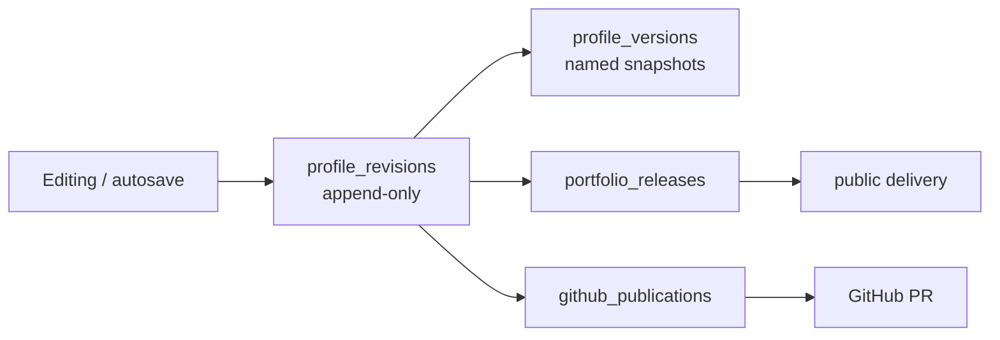
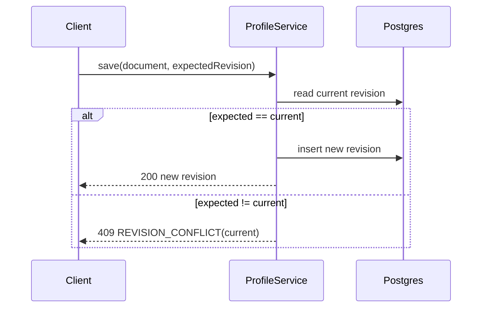

# Versioning & Publishing

**Status:** Architecture design (Phase 2)
**Last updated:** 2026-11-26

---

## 1. Core model

- **Draft revisions:** every save (manual, autosave, import) appends an **immutable** `profile_revisions` row. Drafts are the editing surface.
- **Immutable snapshots:** revisions are never updated; the "current" pointer moves to the newest revision.
- **Export versions:** `profile_versions` are named bookmarks referencing a revision.
- **Published releases:** `portfolio_releases` and `github_publications` are immutable artifacts tied to a specific revision.

## 2. Draft revisions & autosave

- Autosave creates a new revision (`source='autosave'`).
- Revisions are cheap (append-only inserts); history is fully retained.
- `profiles.current_revision_id` tracks the latest.
- Autosaves are non-destructive and never block the user.

## 3. Optimistic concurrency

- Each write carries `expectedRevision`.
- If `expectedRevision != profiles.current_revision`, return `409 REVISION_CONFLICT` with the current revision.
- The client re-reads and retries. A stale autosave never overwrites a newer revision.

## 4. Immutable snapshots

- A revision is immutable once written. "Rolling back" does **not** delete history; it creates a **new revision** whose document equals a prior revision's document (`source='rollback'`, `parent_revision_id` = target).
- This preserves full history and makes rollback safe and auditable.

## 5. Export versions

- `profile_versions` let users label/bookmark a revision (e.g., "v1.0", "launch").
- Export (README download / website export) can create an `export` revision + object-storage artifact.
- Exports are tied to a specific revision → the exported README matches the selected revision.

## 6. Published releases

### 6.1 Portfolio
- `portfolio_releases` references a `revision_id`, a `template_id`, and a `slug`.
- `is_active` marks the live release. Unpublishing sets `is_active=false` + `unpublished_at`.
- **Published rendering is immutable:** editing the draft does not change the active release.
- Public delivery serves only `is_active=true` releases.

### 6.2 GitHub README (via PR)
- `github_publications` references a `revision_id`, installation, repo, branch, and PR.
- The PR is opened from the rendered README of that **immutable revision**.
- Status: `pending → open → merged | closed | failed`.
- Idempotency key prevents duplicate PRs on retry.

## 7. Rollback

- Rollback creates a new revision copying a prior revision's document.
- If a release was published from the rolled-back revision, the release remains immutable (it still references the original revision). Re-publishing requires a new action.
- Rollback is recorded in history (`source='rollback'`).

## 8. Concurrent editing & conflict resolution

- **Model:** optimistic concurrency + append-only revisions.
- Two users editing the same profile concurrently: each successful save creates a new revision; the later `expectedRevision` wins for the "current" pointer, but **no edits are lost** (both revisions exist in history).
- The client reconciles on `409` by reloading the latest revision and merging.
- For a single-user-per-profile model (one profile per user), concurrent editing is primarily autosave-vs-manual; conflicts are surfaced and resolved by re-reading.

## 9. Published vs draft distinguishability

- Drafts: `profiles.status='draft'`, editable, not publicly served.
- Published: tied to an immutable release (`status='published'`), not editable in place; changes require a new revision + republish.
- The UI clearly distinguishes draft vs published states and shows which revision is published.

## 10. Consistency invariants

| Invariant | Enforcement |
|---|---|
| Revisions immutable | append-only table; no updates |
| Published tied to a revision | FK `revision_id` on releases/publications |
| Editing draft doesn't change published | release references immutable revision |
| Stale autosave doesn't overwrite | `expectedRevision` check |
| No duplicate PRs | idempotency key |
| Public serves releases only | delivery reads active releases |
| Rollback preserves history | rollback = new revision |

## 11. Related

- `DATABASE_SCHEMA.md` — revision/release/publication tables.
- `GITHUB_INTEGRATION.md` — PR publishing.
- `RENDERING_ARCHITECTURE.md` — published release rendering.
